Warning: truncated output (original token count: 151393)
Total output lines: 3854

# Backtest Lab — Product & System Architecture Blueprint

> **Domain precedence (Phase 18.4):** [Trading Method & Session specification](TRADING_METHOD_SESSION_SPEC.md) owns current Method/Session semantics. Older mode/version language below is historical design/research terminology where it conflicts: Session inherits its Method, Protocol is Planned-only, checklist OFF retains evidence, and cross-pair coverage is not a maturity requirement. Technical version/hash provenance remains useful; it is not a mandatory user-facing Method-version workflow. These blueprints preserve strategic knowledge and do not authorize runtime changes.

> **Status:** Strategic architecture blueprint / living design document  
> **Scope:** Product architecture, system boundaries, data architecture, research architecture, deployment direction, and evolution from local v1 to research SaaS.  
> **Authority boundary:** This document describes intended architecture. It does **not** authorize implementation, change current phase status, or replace `docs/ROADMAP.md`, `AI_CONTEXT/04_CURRENT_PHASE.md`, completed history, or workflow/Definition of Done.

Related documents:
- [Research Thesis](BACKTEST_LAB_RESEARCH_THESIS.md)
- [Master Roadmap](ROADMAP.md)

---

# 1. Product North Star

Backtest Lab is a **research environment for evidence-based trading decisions**, not a signal seller and not an autonomous trading system.

```text
IDEA → TEST → VALIDATE → STRESS → SIZE → REPLICATE → FORWARD/LIVE → AUDIT → IMPROVE
```

Design principles:

1. Chart-first interaction.
2. Freedom First → Evidence Second → Guardrails Optional.
3. Observe quietly → Analyze deeply → Warn selectively → Never force.
4. Reproducibility over cosmetic complexity.
5. Raw market data is immutable; derived research objects are versioned.
6. Exploratory and confirmatory research must remain distinguishable.
7. Heavy analytics must not block replay UX.
8. Every result must be traceable to data, protocol, engine version, and assumptions.
9. Architecture evolves incrementally; do not prematurely distribute a system that works correctly as a modular monolith.

---

# 2. Architecture at a Glance

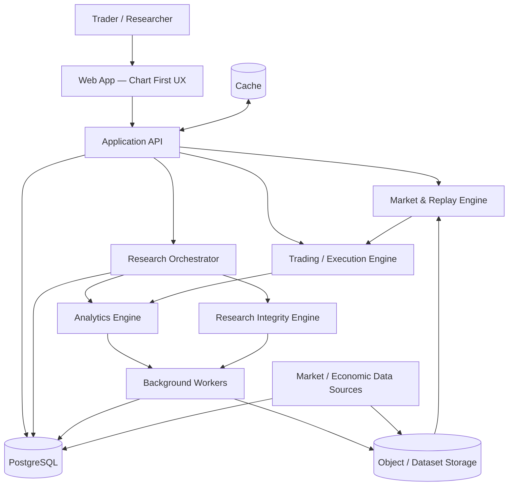

**Initial production direction:** Next.js frontend + FastAPI backend + PostgreSQL. Redis/object storage/workers are introduced only when workloads justify them.

---

# 3. Layered System Design

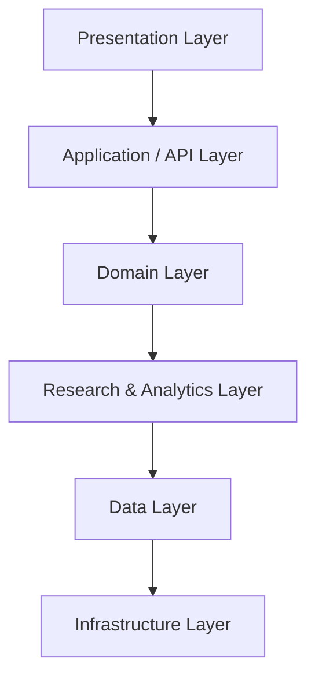

## 3.1 Presentation Layer

Responsibilities:
- chart rendering;
- drawings;
- indicators;
- replay controls;
- order interaction;
- journal;
- Analysis;
- Research/Lab Protocol UI;
- research reports;
- dashboard/workspace later.

The UI should not become the source of truth for trading/research rules.

## 3.2 Application/API Layer

Responsibilities:
- request validation;
- authentication/authorization later;
- use-case orchestration;
- idempotency;
- pagination/query limits;
- job submission;
- API contracts;
- response serialization.

## 3.3 Domain Layer

Pure business/research rules:
- replay state;
- orders/trades/positions;
- risk/reward;
- account/equity;
- strategy protocol;
- experiment lifecycle;
- inclusion/exclusion;
- market regime definitions;
- execution assumptions.

Domain logic should remain testable without browser/database/network dependencies.

## 3.4 Research & Analytics Layer

Contains:
- descriptive statistics;
- statistical evidence;
- RR Laboratory;
- MAE/MFE;
- Monte Carlo;
- survival analysis;
- regime analysis;
- robustness;
- multiple-testing correction;
- OOS/walk-forward;
- portfolio/correlation;
- behavioral/live audit.

## 3.5 Data Layer

Responsible for:
- canonical market data;
- economic events;
- user/workspace data;
- strategies;
- experiment protocols;
- sessions;
- trades;
- research results;
- audit/version history.

## 3.6 Infrastructure Layer

Deployment, observability, backups, queues/workers, caching, CI/CD, security controls, secrets, rate limiting and external integrations.

---

# 4. Frontend Blueprint

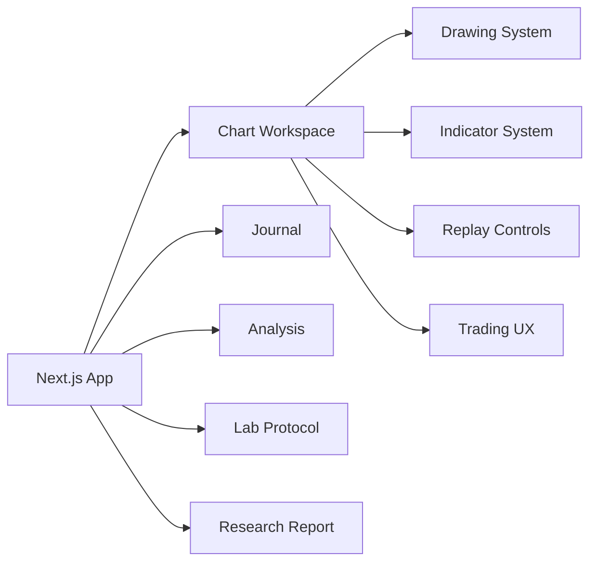

### Frontend state separation

**Ephemeral UI state**
- open panels;
- hover/selection;
- dialogs;
- temporary drawing interaction.

**Session state**
- replay cursor;
- visible range;
- active instrument/timeframe;
- open simulated positions.

**Persisted research state**
- protocol;
- experiment metadata;
- trades;
- exclusions;
- journal;
- result snapshots.

Do not persist everything merely because it can be persisted.

---

# 5. Market Data Architecture

## 5.1 Canonical pipeline

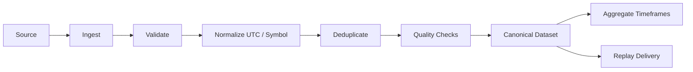

### Canonical candle

```text
instrument_id
timestamp_utc
timeframe
open
high
low
close
volume?
source
dataset_version
quality_flags
```

Raw imported/source data should not be silently mutated. Corrections create a new dataset/version or auditable transformation.

## 5.2 Candle Mode

Primary mode for fast manual research:
- OHLC replay;
- timeframe aggregation;
- deterministic reveal;
- no look-ahead;
- explicit same-candle SL/TP ambiguity.

## 5.3 Tick / Intrabar Mode

Later high-fidelity layer:
- tick/bid/ask data;
- spread;
- execution ordering;
- intrabar path;
- slippage;
- more defensible SL/TP resolution.

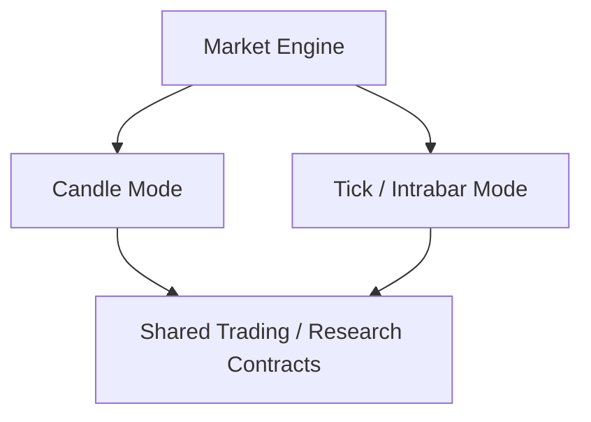

The research layer must know which market/execution mode produced a result.

---

# 6. Replay Engine Blueprint

Core invariant:

> **At replay time t, no component may expose information from t+1 onward.**

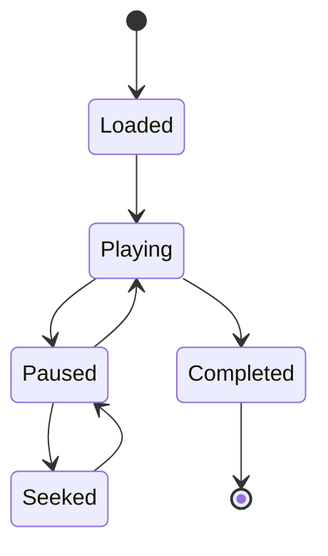

Replay responsibilities:
- deterministic revealed range;
- play/pause/step;
- playback speed;
- high-water/no-look-ahead state;
- event/news synchronization;
- incremental chart updates;
- replay-safe indicator calculation;
- deterministic seed/context where applicable.

Replay does **not** calculate research conclusions.

---

# 6A. Temporal View, Replay State & Canonical Research Log

Temporal correctness should be enforced structurally where practical.

```text
Versioned Dataset
      ↓
TimeBoundedView(t)
      ↓
Replay / Indicators / News / Execution
      ↓
Canonical Event + Trade Log
      ↓
Research Compute
```

A temporal consumer should not receive unrestricted future observations merely because an index is available. Relevant features should support truncation-invariance tests: state/output at `t` remains unchanged when data after `t` is physically absent.

Replay/backtest lifecycle should converge on an explicit state/revision model so chart, replay cursor, trading settlement, journal/event log and later cloud resume cannot silently represent different committed moments. Exact state names are implementation decisions; the invariant is that a committed replay revision has an unambiguous canonical trading/research state.

Research analytics consume canonical logs/results rather than being embedded into the candle loop.

# 7. Trading & Execution Engine

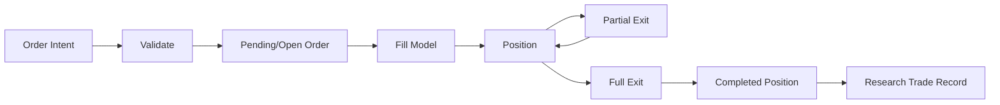

Canonical concerns:
- direction;
- entry;
- SL;
- TP;
- risk;
- quantity;
- fill price;
- commission;
- spread;
- slippage;
- partial exits;
- realized R;
- realized P/L;
- timestamps;
- execution assumptions.

The engine must distinguish **order intent**, **market simulation**, and **research record**.

---

# 8. Experiment Protocol Architecture

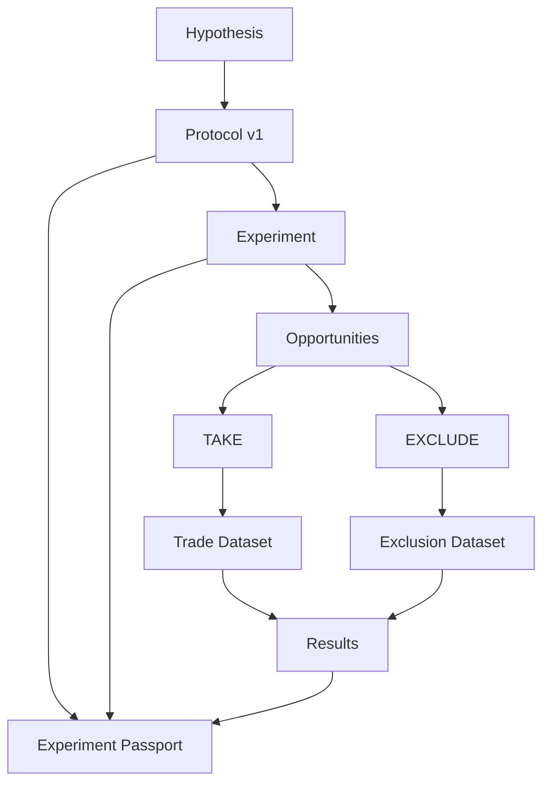

### Protocol object

```text
protocol_id
strategy_id
version
hypothesis
entry_rules
exit_rules
rr_policy
risk_policy
instrument_scope
timeframe
session_scope
inclusion_criteria
exclusion_criteria
planned_sample
stopping_rule
regime_definition_id
execution_assumption_id
created_at
locked_at?
```

Changing a material locked protocol field creates a new version/experiment rather than rewriting history.

---

# 9. Experiment Passport & Reproducibility

Every serious Lab Protocol result should be reconstructible from canonical identity/provenance such as:

```text
Dataset ID + Version + Content Hash
+ Strategy ID + Version + Definition Hash
+ Protocol ID + Version + Content Hash
+ RNG Algorithm + Seed
+ Engine / Research Calculator Version
+ Execution Assumption Version
+ Regime Definition Version
+ Trial / Strategy Lineage
= Experiment Identity
```

Hardware identity is not required by default. Prefer defined numeric semantics and versioned calculators; record additional environment metadata only where it materially affects reproducibility.

Candidate passport fields:
- experiment ID/hash;
- dataset content hash;
- strategy definition hash;
- protocol content hash;
- RNG algorithm/seed;
- trial/strategy lineage and experiment-family reference;
- user/workspace;
- strategy/version;
- instrument/timeframe;
- period;
- dataset/version;
- protocol/version;
- seed;
- engine build;
- execution model;
- regime algorithm;
- planned vs actual N;
- exclusion summary;
- result version.

A result without provenance is descriptive output, not a reproducible research artifact.

---

# 10. Research Engine Architecture

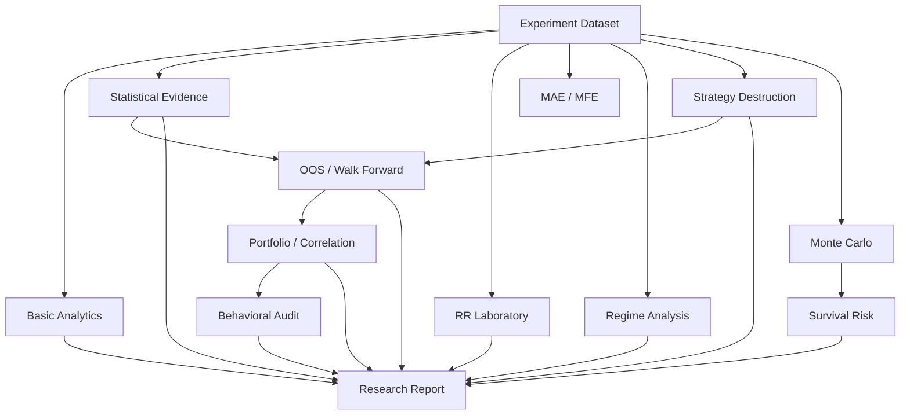

## 10.1 Basic Analytics

Free/descriptive:
- trade count;
- wins/losses;
- WR;
- total P/L;
- total/average R;
- average win/loss;
- profit factor;
- equity;
- historical MaxDD;
- streaks;
- journal.

## 10.2 Statistical Evidence Engine

Candidate outputs:
- break-even baseline;
- uncertainty/confidence intervals;
- expectancy uncertainty;
- sample/effective sample diagnostics;
- power where meaningful;
- pre-registered vs exploratory status.

Never reduce evidence to a universal binary “good/bad strategy”.

---

# 11. RR Laboratory Architecture

RR Laboratory is **post-experiment counterfactual research**.

Wrong design:

```text
Original R × new RR = simulated result
```

Correct direction:

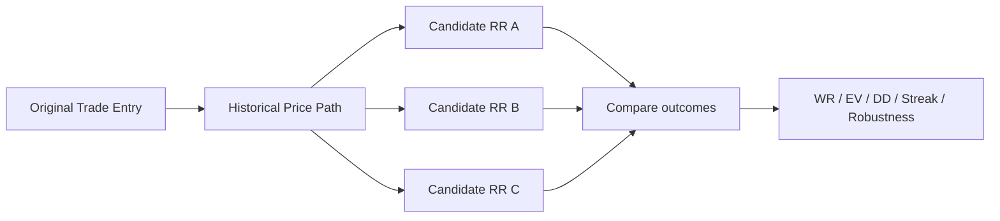

Alternative SL/TP must be evaluated against available historical path at appropriate resolution. Ambiguous paths must be marked rather than invented.

RR Lab output is exploratory unless independently validated.

---

# 12. Strategy Destruction Lab

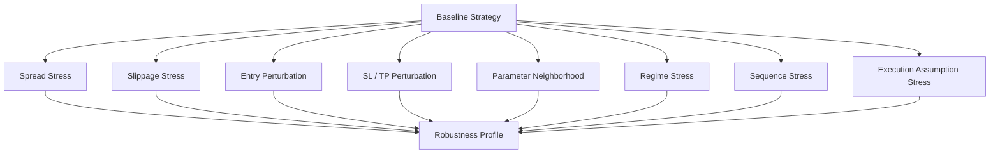

Store baseline, perturbation specification, result, and engine/data version.

---

# 13. Research Integrity Engine

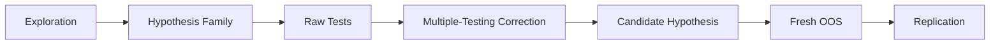

Capabilities:
- append-only trial/strategy lineage;
- hypothesis-family registry;
- number of relevant tests;
- raw p-values;
- Bonferroni;
- Benjamini-Hochberg FDR/q-values;
- exploratory vs pre-registered labels;
- immutable audit trail;
- fresh OOS linkage.

Multiple-testing correction is **not** automatically applied to every stress test or merely because a trial counter increased. Trial history is provenance; the inferential question and hypothesis family determine whether/how Bonferroni, BH-FDR, DSR or another method is appropriate. Sensitivity analysis and inferential hypothesis testing remain distinct concepts.

---

# 14. Monte Carlo & Survival Engine

Inputs:
- empirical R distribution or explicit model;
- sequence/resampling method;
- risk model;
- number of trades;
- number of paths;
- seed;
- constraints/assumptions.

Outputs:
- terminal equity distribution;
- MaxDD distribution;
- losing streak distribution;
- recovery characteristics;
- threshold exceedance probabilities.

Inverse risk design:

```text
r_max = max { r : P(MaxDD >= D*) <= alpha }
```

Long-running simulations belong in background jobs rather than the interactive request path.

---

# 15. Market Regime Engine

Regime definition is a **versioned research object**.

```text
regime_definition_id
name
version
features
thresholds
lookback
warmup
classification_rules
engine_version
```

Examples:
- trend/range;
- low/normal/high volatility;
- session;
- economic-event windows.

No hidden subjective classification in Lab Protocol.

---

# 16. Economic News Architecture


Canonical event candidate:

```text
event_id
timestamp_utc
currency
event_name
category
impact
previous
forecast
actual
source
dataset_version
revision_metadata?
```

News is a research subsystem, not decorative chart icons.

---

# 17. Portfolio & Correlation Architecture

Only activate meaningful portfolio analysis when enough multi-strategy/multi-market data exists.

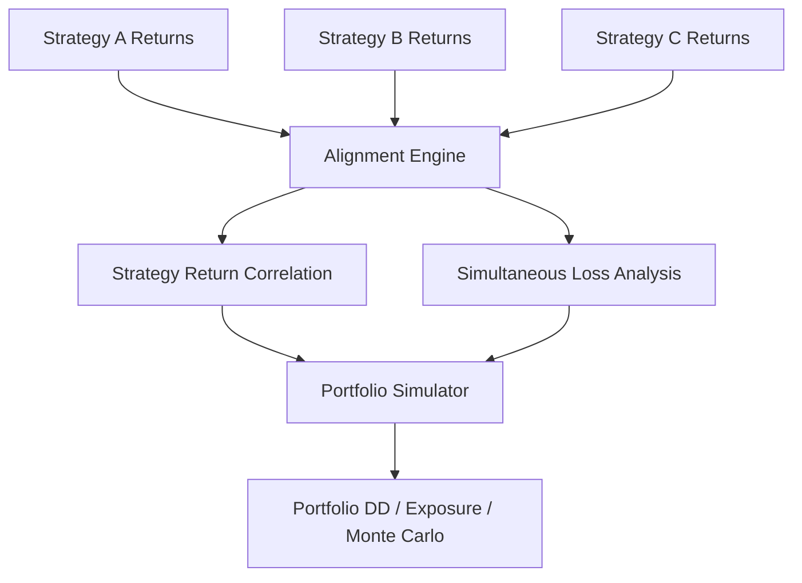

Price correlation alone is insufficient. Strategy-return and concurrent-loss behavior matter.

---

# 18. Behavioral / Live Audit Architecture

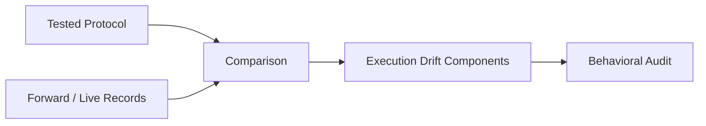

Candidate components:
- ΔRisk;
- ΔEntry;
- ΔSL;
- ΔTP;
- ΔHoldingTime;
- rule violations;
- skipped opportunities;
- frequency changes.

Do not infer psychology. Report measurable behavior.

---

# 19. Data Model Blueprint

Conceptual relationships—not a locked production schema:

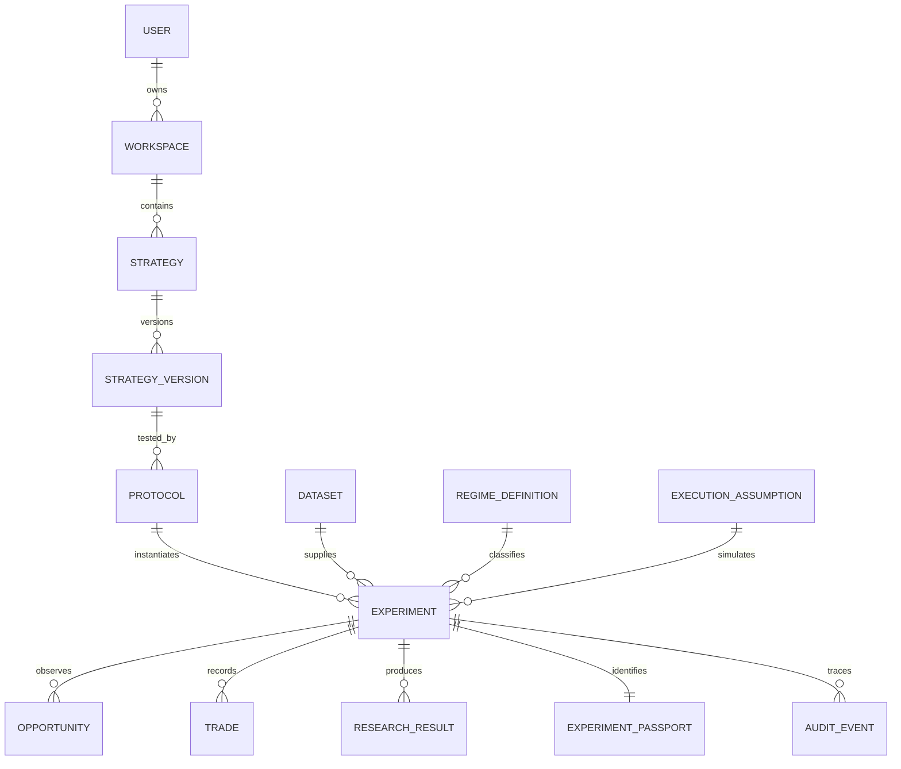

### Core tables/objects later

**Identity**
- users
- workspaces
- memberships

**Trading research**
- strategies
- strategy_versions
- protocols
- experiments
- opportunities
- trades
- trade_events
- journal_entries
- research_results

**Market**
- instruments
- datasets
- candles
- ticks later
- economic_events
- regime_definitions

**Reproducibility**
- experiment_passports
- execution_assumptions
- engine_versions
- audit_events

**Commercial**
- subscriptions
- entitlements
- usage_records

---

# 20. Storage Strategy

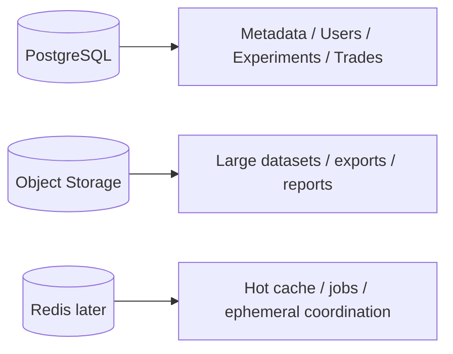

### PostgreSQL
Use for relational/queryable product state.

### Object storage
Use later for large immutable datasets, exports, reports, artifacts and high-volume tick chunks where appropriate.

### Redis
Not mandatory at MVP. Introduce for:
- job queue coordination;
- rate limiting;
- short-lived cache;
- distributed locks where genuinely needed.

Avoid storing canonical research truth only in cache.

---

# 21. API Blueprint

Suggested API namespaces:

```text
/api/v1/auth
/api/v1/workspaces
/api/v1/instruments
/api/v1/datasets
/api/v1/replay
/api/v1/orders
/api/v1/trades
/api/v1/strategies
/api/v1/protocols
/api/v1/experiments
/api/v1/research
/api/v1/reports
/api/v1/jobs
```

Example experiment flow:

```text
POST /protocols
POST /experiments
POST /experiments/{id}/opportunities
POST /experiments/{id}/trades
POST /experiments/{id}/complete
POST /experiments/{id}/research-jobs
GET  /jobs/{id}
GET  /experiments/{id}/report
```

Contracts should be versioned and domain-oriented, not mirror database tables blindly.

---

# 22. Async Job Architecture

Heavy research must not freeze the chart.

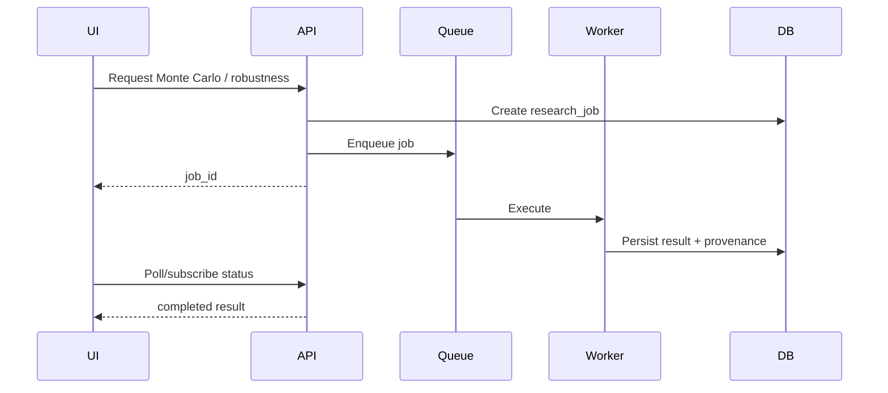

Candidate heavy jobs:
- Monte Carlo;
- RR grid;
- robustness grids;
- walk-forward;
- portfolio simulation;
- report generation;
- large imports.

---

# 23. Free vs Paid Entitlement Architecture

Entitlements must be server-authoritative in SaaS mode.

```text
FREE
├─ Free Backtest
├─ Lab Protocol
├─ ≤ 1 month market window / experiment
└─ Basic Results

PAID
├─ Extended historical data
├─ Statistical Evidence
├─ RR Lab
├─ Monte Carlo / Survival
├─ Robustness / Destruction Lab
├─ OOS / Walk Forward
├─ Regime research
├─ Portfolio / Correlation
├─ Behavioral Audit
└─ Full Research Report
```

Do not fork the scientific protocol into an intentionally invalid “free methodology”. Monetize data depth and analysis depth.

---

# 24. Security & Multi-Tenancy

When cloud/multi-user arrives:

- every user-owned resource has explicit workspace ownership;
- authorization occurs server-side;
- tenant ID/workspace ID is never trusted solely from client input;
- rate limits;
- secure session/token lifecycle;
- CSRF/XSS/SQL injection protections as applicable;
- secrets outside source control;
- encrypted transport;
- backup/restore testing;
- audit events for sensitive mutations;
- signed/expiring URLs for private object storage;
- least-privilege service credentials.

Research data isolation is a product requirement, not an optional hardening task.

---

# 25. Performance Blueprint

Priority model:

1. Security and correctness are hard constraints.
2. Determinism/reproducibility where promised.
3. Lightweight by default: avoid unnecessary work.
4. Measure relevant render/CPU/memory/query/I/O behavior.
5. Optimize demonstrated bottlenecks.
6. Scale through preserved boundaries when evidence requires it.

Techniques:
- incremental chart updates;
- chunked candle loading;
- timeframe aggregation/cache;
- indexed time-series queries;
- bounded API responses;
- lazy research panels;
- background heavy computation;
- memoized/pure indicator calculations where appropriate;
- compression for bulk datasets;
- pagination;
- load tests before infrastructure guessing.

Do not move to microservices merely because the product may someday have many users. Do not replace official chart-library behavior with custom canvas/virtualization without measured evidence that rendering is the bottleneck.

---

# 26. Deployment Blueprint

## Stage A — Local v1

```text
Browser
  ↓
Local app / local service
  ↓
Imported market data
```

Goal: research correctness and professional manual backtesting.

## Stage B — First hosted deployment

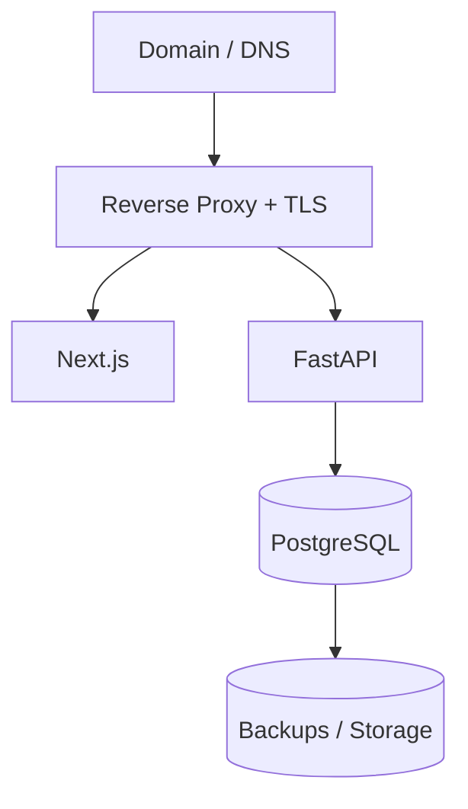

A single VPS can host the early system while usage is modest.

## Stage C — Scaled SaaS

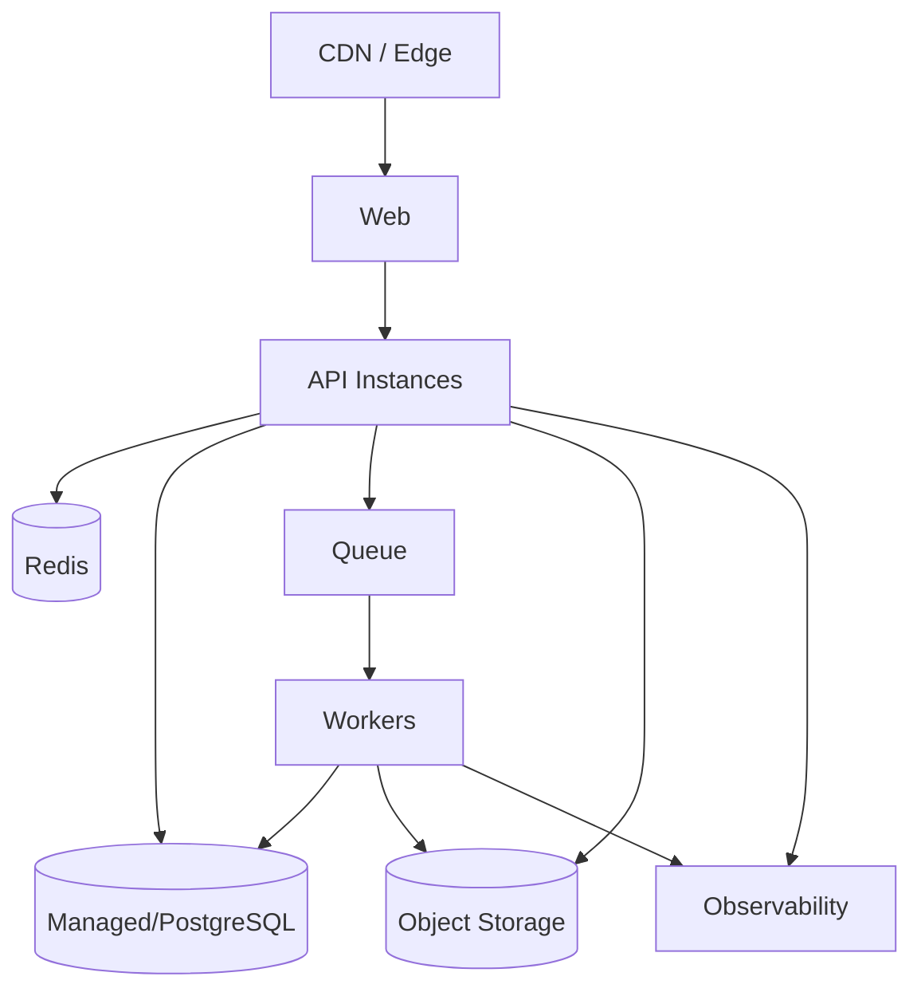

Scale based on measured bottlenecks, not imagined traffic.

---

# 27. CI/CD Blueprint

```mermaid
flowchart LR
    DEV[Change] --> GIT[Git Commit]
    GIT --> CI[CI]
    CI --> TEST[Test + Lint + Build]
    TEST --> GATE{Pass?}
    GATE -- No --> STOP[Stop]
    GATE -- Yes --> MAIN[Validated Main]
    MAIN --> DEPLOY[Deploy]
    DEPLOY --> SMOKE[Smoke / Health Check]
```

Production deployment later should support:
- reproducible builds;
- environment-specific configuration;
- migrations;
- rollback;
- health checks;
- deployment logs.

---

# 28. Observability

Minimum production signals:

**Application**
- request rate;
- error rate;
- latency;
- job failures;
- queue depth.

**Data**
- import failures;
- missing intervals;
- duplicate timestamps;
- dataset/version lineage.

**Research**
- engine version;
- job duration;
- failed simulations;
- result provenance.

**Infrastructure**
- CPU;
- memory;
- disk;
- DB connections;
- backup status.

Observability must not leak private strategy data into logs.

---

# 29. Versioning Rules

Version independently where appropriate:

```text
App Version
Engine Version
Dataset Version
Protocol Version
Strategy Version
Regime Definition Version
Execution Assumption Version
Research Result Version
```

A historical result must remain interpretable even after future engine upgrades.

---

# 30. AI Architecture Boundary

AI is a **research assistant**, not the canonical calculator.

AI may:
- summarize results;
- explain statistical concepts;
- surface anomalies;
- propose hypotheses;
- compare experiment reports;
- help construct protocol drafts.

AI must not silently:
- rewrite canonical trade history;
- fabricate market data;
- alter experiment parameters after results;
- replace deterministic calculations;
- claim a strategy will be profitable;
- receive autonomous real-money execution authority from this architecture.

```mermaid
flowchart LR
    DATA[Verified Research Results] --> AI[AI Research Assistant]
    AI --> INSIGHT[Explanation / Hypothesis]
    INSIGHT --> HUMAN[Human Decision]
    HUMAN --> NEW[New Protocol / Experiment]
```

---

# 31. Failure & Recovery Principles

Design for:
- browser refresh;
- interrupted replay;
- failed import;
- failed analytics job;
- worker restart;
- DB migration failure;
- partial network outage;
- stale client state.

Rules:
- writes should be idempotent where feasible;
- incomplete jobs have explicit state;
- canonical data is never inferred from a failed partial result;
- backups are useful only after restore has been tested;
- experiment provenance survives recovery.

---

# 32. Evolution by Product Version

| Version | Architectural identity |
|---|---|
| v1.0 | Local/manual research platform; validated replay/trading/analysis |
| v2.0 | Cloud multi-user foundation: API, PostgreSQL, auth, workspaces, cloud market data |
| v3.0 | Professional research: strategies, journal, analytics, regime, portfolio, Monte Carlo |
| v4.0 | High-fidelity execution: tick, bid/ask, spread, costs, slippage, intrabar |
| v5.0 | SaaS operations: subscriptions, teams, RBAC, collaboration, audit, admin |
| v6.0 | Quant research: datasets, experiments, parameter research, walk-forward, robustness, AI research assistant |
| v7.0 | External/live/paper/forward-testing infrastructure and algorithmic-readiness validation |

This table summarizes the existing roadmap. It does not authorize any future phase.

---

# 33. Architectural Non-Negotiables

1. No look-ahead.
2. Deterministic replay where deterministic behavior is promised.
3. Canonical trade/execution records.
4. Versioned research assumptions.
5. Reproducible Lab Protocol experiments.
6. Explicit ambiguity instead of invented certainty.
7. Exploration ≠ validation.
8. Multiple-testing awareness.
9. Fresh OOS/replication for stronger evidence.
10. Heavy analytics outside latency-sensitive chart interaction.
11. Server-authoritative ownership/entitlements in SaaS mode.
12. AI interprets verified results; deterministic engines calculate them.
13. No autonomous real-money execution within the current roadmap boundary.
14. Do not replace a working modular architecture with microservices without measured need.

---

# 34. Target Repository Structure

Conceptual target; existing validated paths must not be moved merely to match this diagram.

```text
apps/
  web/
  api/

engine/
  market/
  replay/
  execution/
  risk/
  indicators/
  statistics/
  monte_carlo/
  research_integrity/
  regime/
  robustness/
  portfolio/

research/
  protocols/
  experiments/
  reports/

data/
  import/
  validation/
  aggregation/

workers/
  research_jobs/

tests/
  unit/
  integration/
  regression/
  e2e/

docs/
  ROADMAP.md
  BACKTEST_LAB_RESEARCH_THESIS.md
  PRODUCT_SYSTEM_ARCHITECTURE_BLUEPRINT.md
```

Repository refactoring should happen only under an explicitly authorized implementation phase.

---

# 35. One-Page Blueprint

```mermaid
flowchart TB
    USER[Trader / Researcher]
    UX[Chart-First Backtest Lab]
    CORE[Replay + Trading + Journal]
    PROTOCOL[Lab Protocol + Experiment Passport]
    DATA[Versioned Market / News / Trade Data]
    RESEARCH[Evidence + RR Lab + Regime + Robustness]
    RISK[Monte Carlo + Survival]
    INTEGRITY[Multiple Testing + OOS + Replication]
    PORT[Portfolio / Correlation]
    AUDIT[Behavioral / Live Audit]
    AI[AI Research Assistant]
    CLOUD[API + PostgreSQL + Workers + Object Storage]

    USER --> UX
    UX --> CORE
    CORE --> PROTOCOL
    PROTOCOL --> DATA
    DATA --> RESEARCH
    RESEARCH --> RISK
    RESEARCH --> INTEGRITY
    INTEGRITY --> PORT
    PORT --> AUDIT
    AUDIT --> AI

    CORE <--> CLOUD
    PROTOCOL <--> CLOUD
    DATA <--> CLOUD
    RESEARCH <--> CLOUD
```

## Final architecture thesis

> **Backtest Lab should feel simple at the chart, strict in the data, transparent in the assumptions, and deep in the research.**

The chart is the workspace.  
The experiment is the unit of research.  
The dataset is evidence.  
The passport makes evidence reproducible.  
The research engines measure uncertainty.  
The human remains the decision-maker.


---

# 36. Extensible Market Data & Indicator Import Boundary

> **Status:** Architecture direction, not current implementation authorization.

Backtest Lab must not be permanently coupled to Twelve Data, one broker feed, one file format, or only the indicators bundled with the application.

## Market Data Source Adapters

Canonical flow:

```text
Twelve Data / Broker / CSV / Parquet / Future Provider
                     ↓
              Provider Adapter
                     ↓
          Normalize + Validate
                     ↓
        Canonical Market Dataset
                     ↓
     Dataset Version + Content Hash
                     ↓
 Replay / OOS / Forward / Research
```

Initial development candidate:
- Twelve Data may be used as a low-cost/free trial source for forward-engine development where the selected symbol and account tier permit it.
- It is not a permanent provider dependency.
- Commercial display/redistribution rights must be re-verified before public use.

A provider adapter should describe source/provider identity, instrument mapping, price type where known, timestamp/timezone semantics, interval, latency/completeness metadata, and licensing/usage metadata where relevant.

New providers should be addable without rewriting Replay, Execution, Experiment Passport, or Research Compute.

## User Market-Data Import

Backtest Lab should support user-supplied market datasets through a validated import boundary.

Candidate formats:
- CSV first;
- additional structured formats such as Parquet later when justified;
- provider/API adapters separately.

Import must validate schema, timestamps, ordering, duplicates, gaps, numeric values, OHLC invariants, timezone semantics, instrument metadata, and file/resource limits. Imported datasets receive immutable version identity/content hash before research use.

Never silently merge incompatible providers or price semantics into one canonical experiment dataset.

## Indicator Extensibility

Built-in indicators remain deterministic/versioned research components, but the architecture should allow additional indicators to be imported or installed later.

Conceptual boundary:

```text
Built-in Indicator
Imported Indicator Definition
Future Approved Plugin
          ↓
   Indicator Contract
          ↓
TimeBounded Market View
          ↓
Deterministic Output Series
          ↓
Chart Pane / Overlay + Research
```

Minimum indicator contract should eventually define:
- stable indicator ID and version;
- name/metadata;
- parameters and validation schema;
- required input series;
- warm-up requirement;
- output series/panes;
- deterministic calculation semantics;
- no-look-ahead/time-bounded input;
- compatibility/version metadata.

## Safety Boundary for External Indicators

“Import indicator” must **not** mean executing arbitrary untrusted Python/JavaScript in the main application process.

Preferred progression:
1. import safe declarative indicator definitions/configuration where possible;
2. support approved/versioned plugin packages only after a plugin security model exists;
3. arbitrary user code, if ever supported, requires a separately designed sandbox with CPU/memory/time/network/filesystem limits and is not authorized by this blueprint.

External indicators must not gain implicit access to secrets, other users' data, billing, filesystem, network, or future replay observations.

## Reproducibility

An experiment using imported data or an external indicator must record enough identity to reproduce the claim, including applicable:
- Dataset ID/version/content hash;
- data provider/source;
- Indicator ID/version/definition hash;
- indicator parameters;
- engine/calculator version;
- execution model version.

Changing an imported indicator definition after an experiment must create a new version rather than silently changing historical results.

## Design Principle

**Import at the boundary; normalize into canonical contracts; keep the research core provider-neutral.**

This lets Backtest Lab start cheaply while preserving the ability to add better data feeds and a larger indicator ecosystem later.


---

# 37. Open-Source Dependency Adoption Plan

> Status: planning direction only; no installation or implementation is authorized here.

Backtest Lab should use open source for commodity infrastructure while keeping replay/execution semantics, Lab Protocol, Experiment Passport, research integrity, and evidence methodology product-owned.

## Adoption rule

Adopt a dependency only when there is a demonstrated need and the project has checked commercial licensing/attribution, maintenance, security, performance cost, architectural fit, and replacement boundaries. A planned candidate is not automatically an installed dependency.

## Candidate map

| Capability | Candidate | Planning status |
|---|---|---|
| Financial market chart | TradingView Lightweight Charts | Existing foundation |
| Browser end-to-end QA | Playwright | Evaluate, likely useful for v1 hardening |
| Backend API | FastAPI | Planned candidate for Phase 19 |
| Relational product state | PostgreSQL | Planned candidate for Phase 20 |
| Research visualization | Apache ECharts | Evaluate for advanced research UI |
| Columnar/dataframe transforms | Polars | Evaluate when measured workload justifies |
| Embedded analytical SQL and CSV/Parquet analysis | DuckDB | Evaluate when dataset/research workload justifies |
| Scientific/statistical primitives | SciPy | Evaluate for advanced research engines |
| Statistical inference/models | statsmodels | Evaluate for advanced research engines |
| Object storage | S3-compatible boundary | Defer implementation/provider choice |
| Background jobs | Lightweight worker/job abstraction | Defer library choice until heavy jobs exist |
| Authentication | Mature OIDC/session solution | Defer exact choice to cloud auth phase |
| Observability | OpenTelemetry-compatible instrumentation | Evaluate for production hardening |
| Dependency/security checks | Ecosystem-native CI tooling | Evaluate before public production |

## Visualization boundary

Keep Lightweight Charts for market/replay. Evaluate ECharts for research-specific views such as Monte Carlo distributions, drawdown/recovery distributions, regime heatmaps, parameter surfaces, robustness views, and portfolio/correlation visualizations.

## Data and research compute boundary

Potential future flow:

```text
Versioned Dataset / CSV / Parquet
              ↓
       DuckDB / Polars
              ↓
Deterministic Backtest Lab Research Logic
              ↓
     SciPy / statsmodels primitives
              ↓
 Canonical Research Result + Provenance
              ↓
       ECharts / Reports
```

DuckDB/Polars are analytical candidates, not replacements for PostgreSQL application state.

Libraries may provide primitives and execution machinery, but Backtest Lab remains authoritative for Lab Protocol, Experiment Passport, no-look-ahead, execution assumptions, canonical Event/Trade Log, hypothesis-family definition, multiple-testing policy, Monte Carlo experiment definition, survival/risk-sizing, Strategy Destruction, and evidence interpretation.

## QA priority

Playwright is a strong E2E candidate for replay/navigation, drawings/indicators, order lifecycle, Fixed-RR restrictions, checklist ON/OFF, timeframe switching without temporal leakage, reset/recovery, entitlements, and Free affiliate versus paid ad-free UI.

E2E tests complement deterministic unit/domain tests; they do not replace them.

## Infrastructure restraint

Do not introduce ClickHouse, Redis, Kafka/RabbitMQ, Kubernetes, vector databases, microservices, arbitrary user-code execution, or a custom chart renderer by default. Adopt heavier infrastructure only after a measured workload or concrete requirement proves the simpler architecture insufficient.

## Dependency gate

Before adoption, verify the exact package and license, attribution/NOTICE obligations, current maintenance, security posture, version-lock strategy, material transitive dependencies, and the replacement boundary for critical components.

## Rollout principle

**Do not install an OSS dependency because it appears on this plan. Install it at the phase where it eliminates a real problem.**

Quality order remains:

**Security + Correctness → Lightweight → Efficient → Measured → Scalable.**

# 38. Phase 19 — Backend architecture planning handoff

This section extends the existing architecture owner. It is a planning deliverable, not a production API, schema, deployment or implementation authorization. Baseline audited: `15102e55ab31bc6ec5b7e98067af45d58126dc83`, clean main equal to origin and actual GitHub. Operational authorization remains only in [04_CURRENT_PHASE](../AI_CONTEXT/04_CURRENT_PHASE.md). Product semantics remain in the [frozen Method/Session handoff](TRADING_METHOD_SESSION_SPEC.md#frozen-trading-ux-specification-v1); security in [SECURITY_ARCHITECTURE](SECURITY_ARCHITECTURE.md), engineering in [AI_ENGINEERING_GUARDRAILS](AI_ENGINEERING_GUARDRAILS.md), infrastructure/commercial/provider decisions in [SCALING_DATA_AI_DECISIONS](SCALING_DATA_AI_DECISIONS.md). This is not another roadmap or Definition of Done.

## 38.1 Observed baseline and direction

React/Vite + Lightweight Charts is the active workspace; local account, drawing and news repositories own their existing independent storage. The explicit trading UX prototype is memory-only. `backend/api/main.py` exposes a standalone FastAPI 0.4.0 prototype with a module-level ReplayService and in-memory datasets/sessions. Its replay/trading engines have standalone tests; frontend production does not depend on these endpoints. Current handlers use coarse validation/error mapping and development CORS (including null origin), with no production identity, membership, durable idempotency or transactional persistence. These are observed integration gaps, not authorization to repair or deploy the prototype.

Retain React/Vite and chart/engine behavior. Earlier Next.js language is strategic, not a frontend migration prerequisite. Plan FastAPI as the existing backend direction, with thin transport handlers and framework-independent use cases/domain contracts. No dependency is installed or endorsed as production-ready here; exact versions, compatibility, licenses and security must be verified at implementation. PostgreSQL remains the Phase 20 direction; schema/migrations, auth/token mechanics and ownership implementation belong to separately authorized phases. Do not silently promote the old Python engine to canonical execution or port the JS simulator: later integration needs differential fixtures and a human-approved execution-authority decision if parity fails.

## 38.2 Modular monolith and ownership

Initial deployment direction is one application with explicit modules and replaceable ports, not microservices. Domain imports must not depend on transport, SQL, vendor clients or UI. Handlers → application use cases → pure domain rules → repository/provider ports; composition supplies infrastructure adapters. Proposed module names are conceptual, not folders created by this task.

| Boundary | Owns / input-output | Must not own |
| --- | --- | --- |
| Presentation | TIME + PRICE planner, chart, draft, ticket/review, displayed errors and read projections | Canonical authorization, persisted financial outcomes or server credentials |
| Product application / Product DB port | Authorized Method/Session lifecycle, command sequencing, revisions, durable confirmation receipts, journal references | Research algorithms, provider-specific identifiers as product identity |
| Market / temporal view | Dataset manifests/rights, immutable feed identity, revealed revision and bounded candle/news access | Future observations in interactive consumers, trading outcomes |
| Execution domain port | Validated intent, deterministic replay settlement, pending/fill/partial/exit events and account reconciliation | Drawing state, HTTP handlers, AI decisions; no dual writer with v1 |
| Research Compute | Read-only canonical evidence snapshot, passport and versioned calculator → result artifact | Interactive replay loop, direct account mutation, unrestricted tenant data |
| Billing / Entitlement | Internal capability decision from auditable commercial state | Payment-provider status directly authorizing execution/research |
| AI Gateway | Authorized minimal context, bounded tool requests, provider abstraction | Financial truth, automatic orders, secrets in prompts |
| Integration / CRM | Allowlisted business projections and idempotent outbound integration | Canonical research ledger or blocking replay on CRM availability |

Only boundaries are planned for Billing, AI and CRM; no payment, subscription, AI or Odoo implementation. Product state cannot depend on their availability. Workers may later run separately using the same domain and contracts when measured workloads justify it. No Redis/queue/microservice requirement is introduced.

## 38.3 Request and API contract

Proposed versioned resources under `/api/v1` are contracts to implement later, not available routes. Workspace-scoped Methods/Sessions, Session command/confirmation receipts, bounded event/position projections, dataset manifest/temporal views, Experiment Passports/trial lineage and research-job status form the minimal seams. Avoid CRUD endpoints that let clients insert arbitrary canonical fills or P&L. Existing unversioned prototype routes stay unchanged and are not aliases for this contract.

Command envelope: schemaVersion, requestId/idempotencyKey, sessionId, method definition reference/hash, expectedSessionRevision, expectedQuoteRevision, instrument/feed/profile references, workflow/type/side, decimal levels/quantity/risk inputs, condition observations and planId/revision when Planned. The server resolves authoritative ownership/Method/Session/quote/profile; client values are assertions, not trusted policy. Store the reviewed request snapshot separately from resulting execution events. API contract names and wire DTOs require a reviewed schema before implementation.

Future flow: authenticated principal → membership/resource check → bounded runtime DTO validation → current Session/Method/profile/temporal-view resolution → independent domain validation (including Protocol ON/OFF) → explicit confirmed command → atomic revision/idempotency check plus execution/evidence write → committed receipt/projection. Drawing placement/draft/preview and ticket opening never execute a command. Cancellation before confirmation submits nothing; pending cancellation is a distinct recorded abandonment. Protocol OFF never bypasses fixed risk/RR or categorical restrictions. Unknown observations stay NOT_ASSESSED; no implicit PASS.

Confirmation dedup key is scoped to verified workspace + Session + operation + request identity, with a canonical payload digest. Same identity/payload returns the existing receipt even after later Session revisions; a conflicting payload refuses. New commands compare expected revision under the same transactional/serialization boundary as side effects. Concurrent confirmations cannot both execute; crash/retry cannot duplicate a fill. Reject stale commands before mutation. Receipts reference committed Session/event revisions; clients reconcile by receipt/state rather than retrying with new identities after uncertain delivery. Review expiry and dedup retention must be specified before implementation; receipt identity for financial actions must remain recoverable through retries/restore.

Use explicit domain errors (INVALID_INPUT, PROTOCOL_BLOCKED, STALE_REVISION, IDEMPOTENCY_CONFLICT, RESOURCE_UNAVAILABLE) and correlation IDs. Planned mapping: malformed input 400, failed numeric/domain validation 422, revision/idempotency conflicts 409, absent identity 401, denied access 403 or consistent non-disclosing 404; pending heavy work 202 with status reference. These are target conventions, not changes to current 400/404 prototype behavior. Bound pagination, upload sizes, query windows and concurrency; define measured limits before production, never unrestricted history by default.

## 38.4 Persistence-facing identity and evidence contracts

| Record | Required identity/content and invariants |
| --- | --- |
| Method definition | Stable methodId, workspace owner, Free Style/Protocol type, immutable definition reference/hash, conditions/enforcement/risk/RR policy. Technical snapshots do not create a mandatory user-facing version editor. Material changes preserve prior meaning. |
| Session / feed segment | Stable sessionId, inherited Method definition, instrument/feed/dataset version, starting balance and risk basis, costs/execution profile, committed revision and revealed boundary. Feed continuation creates an explicit linked segment rather than rewriting prior evidence. |
| Confirmed intent / receipt | Request identity, canonical digest, actual condition observations, reviewed quote/plan revisions, validation policy and committed outcome references. Client confirmation is not itself proof of fill. |
| Canonical event / trade log | Stable eventId, owner/session, monotonic per-Session sequence, event schema, engine/policy version, market time plus recorded UTC time, causal request/position/exit references, source, actual quantity/costs and resulting revision. Partial exit stays distinct from completed position. |
| Experiment Passport | Stable experimentId + immutable passport revision/content digest; dataset identity/version/hash, Method definition hash, protocol definition hash where applicable, engine/calculator version, execution assumptions/profile, instrument/feed/period, regime definition and RNG algorithm/seed when used, input snapshot/log boundary and trial/family references. Missing inputs prevent reproducibility certification. |
| Trial / strategy lineage | Append-only trialId, parent/family/experiment references, definition hashes, exploratory/confirmatory declaration and recorded reason/time; abandoned/failed/excluded attempts remain discoverable. Lineage does not automatically trigger multiple-testing correction. |
| Research result | Job/passport/input-snapshot identity, calculator/numeric policy/version, parameters/seed, artifact hash and diagnostics. A changed input/calculator produces a new result identity, not overwritten evidence. |

Append-only applies to canonical research/financial evidence: corrections append a linked superseding/correction event and projections retain prior meaning. Mutable notes/preferences remain separate. This does not forbid legally required erasure: implement privacy/retention policy and controlled auditable deletion/redaction at the appropriate phase; do not promise perpetual private-data retention. Event ledger is separate from sanitized operational logs. Projections must be rebuildable/reconciled; cache and RAM are not canonical truth. Atomic event/receipt/revision persistence is a Phase 20 design requirement, not an implemented transaction.

Hash contract proposal: SHA-256 over UTF-8 canonical JSON with schemaVersion; sorted object keys, preserved array order, explicit null vs absent semantics, UTC timestamps and normalized finite decimal strings (no NaN/Infinity or negative-zero ambiguity). Identity hash excludes mutable display labels, secrets and operational recorded times; evidence artifact digest may include recorded times. Cross-language golden vectors and exact decimal/rounding policies must be approved before any producer adopts this format. Content hash proves byte identity, not authenticity or compliance. Do not invent hashes, initial risk, cost metadata or timestamps for legacy records; preserve originals and label unavailable provenance.

## 38.5 Research job and temporal boundary

Proposed job input: verified owner, jobId/idempotency identity, passport/input artifact hashes, calculator version, parameters, optional RNG metadata and resource policy. State transitions: QUEUED → RUNNING → SUCCEEDED / FAILED / CANCELLED; CANCEL_REQUESTED is nonterminal, timeout is a classified failure. Progress is descriptive, never a research result. Durable status/result publication, bounded attempts, deadlines/concurrency/memory budgets and cooperative cancellation belong to the later adapter. At-least-once retries may recompute but cannot publish duplicate canonical results. Recheck ownership on submission/status/download and worker artifact resolution; results publish atomically only against matching snapshot identity.

Interactive replay, indicator, news and execution consumers receive only TimeBoundedView(revision, revealedTime), never an unrestricted dataset. Session settlement/event append and replay acknowledgement must describe the same committed revision. Research jobs may access a separately authorized completed evidence interval or retrospective price path; those results must remain labeled and cannot leak into a still-running strict replay view. Test physically truncated futures, not only UI-hidden fields. Heavy compute never runs in synchronous chart/order handling. No Monte Carlo/advanced analytics/worker runtime is built here.

## 38.6 Trust, adoption and acceptance gates

Browser storage and imported data are untrusted. Validate schema, numeric units, finite bounds, content size/hash and temporal availability at each boundary. Never accept principal, membership, entitlement or source claims from a hidden button/client-supplied workspace ID. Until production identity/membership exists, new private-resource paths must remain disabled or test-only with explicit injected principals, not publicly exposed without authorization. CORS is not authorization; development null-origin settings are not a deployment policy. Credentials belong to server secrets configuration, never frontend bundles, passports or logs. Token/session mechanics, CSRF policy and public launch checks remain with the security owner and later identity scope.

Implementation preparation order (within existing phase owners, no second roadmap): approve DTOs/golden fixtures and ports; separately authorize a narrow backend foundation; separately authorize Phase 20 persistence/migrations/restore; follow identity/workspace phases before private cloud exposure; then authorize one guarded production adapter with rollback and differential evidence. No automatic frontend rewrite, local storage upload/migration or Python engine switch. Existing `/` and prototype entry remain isolated until a reviewed cutover; never run two canonical execution writers. Exact limits, hash vectors, privacy retention, runtime engine parity and deployment/auth choices are implementation prerequisites, not hidden product decisions made by this document. Material contract conflicts require human resolution.

Future implementation acceptance matrix:

| Gate | Required proof before integration/release |
| --- | --- |
| Domain parity | Existing regression plus cross-runtime fixtures for risk/decimal rounding, order relations, pending/fill/partial/exit, costs and ambiguity; discrepancies block cutover |
| Confirmation/recovery | Same/different payload retries, concurrent confirmations, stale revisions, crash between commit/ack, restart/restore, receipt recovery; exactly one financial effect |
| Protocol/evidence | Quick/Market/locked fields/manual intervention refused even direct API; ON missing/FAIL blocks, OFF preserves observations; no fabricated compliance |
| Temporal integrity | Physical-future truncation invariance; quote/replay/settlement revisions consistent; research artifacts cannot reveal future data to strict replay |
| Ownership/security | Cross-tenant reads/writes/job artifacts/exports denied, bounded requests, sanitized errors/logs, no client secrets; existing security launch gate applies |
| Persistence/provenance | Append/correction lineage, immutable snapshots/hash vectors, missing legacy metadata retained, replayable projections and account reconciliation, backup/restore identity equality |
| Jobs/boundaries | Timeout/cancel/retry/resource limits and duplicate result publication tests; provider/CRM/AI outages cannot alter trading truth |
| Compatibility | Existing account/drawing/news storage untouched, full frontend regression/build/lint/release/bundle, future backend tests and actual browser cutover smoke |

Planning closure: only documentation/context and bundle allowlist change. Existing repository and AI-bundle controls validate authority/link inclusion; regenerate and verify the disposable bundle. Browser verification is exempt with reason: no runtime, UI, API, build entry, dependency, database or engine changes. This checkpoint closes Phase 19 planning only; Phase 19 implementation and Phase 20 remain unauthorized until explicitly requested by the human.

## 38.7 Authorized foundation checkpoint — implementation evidence

The human subsequently authorized only framework-independent contracts, pure validation, canonical serialization/hash fixtures and deterministic tests from clean verified `aa3b982728b3e7f36278bbbf8a5c6f24e6b410a6`. `backend/contracts/` now implements this narrow seam using Python standard library; no existing service/engine imports or integration. This is a completed foundation checkpoint, not all Phase 19/backend completion. Sections above retain their future integration meaning.

Frozen DTOs cover Method policy/condition observations, resolved Session/quote assertions, Command, ReviewedRequest, ConfirmedRequest, receipt comparison, event identity, Passport revision/identity, trial lineage, research-job input/state and temporal observations. Mutable lists are refused at tuple boundaries; exact IDs/categories/revisions/hash formats and aware timestamps are validated. Decimal inputs accept exact strings/ints/Decimal and refuse binary floats/bools, nonfinite values and unsupported forms. Pure command validation compares supplied context identity/revisions, market/pending relations, stop/target sides and Protocol Planned/pending/risk/RR/ON checks. OFF preserves FAIL/NOT_ASSESSED and still refuses categorical actions. RR comparison uses exact rational arithmetic independent of Decimal context. Context is an asserted future-server input, not authenticated principal evidence.

BTL-CJSON-1 is a project-local format, not RFC 8785. Root schemaVersion is exactly integer 1; keys sort by Unicode code point, arrays retain order, null remains explicit and absent remains absent. Strings are Unicode scalar sequences (no normalization); UTF-8 compact JSON escapes controls, quote and backslash. Integers are limited to safe 53-bit range; Decimal becomes a normalized exact string with no exponent/trailing fractional zero/negative zero; aware datetime becomes UTC ISO text with six fractional digits and Z. Ordinary strings retain their meaning: DTO schema distinguishes decimal/time fields, so generic numeric-looking strings are not coerced. Float, unsupported object types, naive time, excessive depth/collections/text/decimal exponent and unsupported root versions refuse. Identity builders include only defined DTO identity content; reviewed/recorded wall time is separate from command/passport identity. SHA-256 is content identity, never authorization, signature or invented compliance.

Six committed golden fixtures in `backend/tests/fixtures/contract_hash_vectors.json` cover decimal/time/Unicode, exponent expansion, absent field, Unicode-key sorting, integer-looking-key sorting and microseconds. Python tests compare exact expected bytes/digests across repeated runs. `backend/tests/verify_contract_vectors.mjs` independently renders the fixture subset with Node standard library and explicit sorted-key serialization, avoiding JS integer-key enumeration differences. Python contract tests also cover field-order invariance, array sensitivity, null vs absent, malformed numeric/category/ID/schema, immutability, stale revisions, Protocol bypass/refusal, confirmed-time ordering, receipt scope/conflict, Passport/RNG/job identity/deadlines/state and event revealed-time checks. Temporal view equals a physically truncated prefix and ignores changed future values; this proves only the new availability-view primitive, not a new engine or strict-delivery integration.

Validation: all 63 backend tests (53 retained + 10 new test methods with parameterized assertions) pass using existing venv; bundled Python independently passes the 10 foundation tests. Six Node golden vectors pass three repeated runs. Full registered frontend regression, lint/build/release pass. Final repository/bundle regeneration/verification and diff/Git gates close the checkpoint. No tests weakened, dependencies added, files deleted, routes/frontend/engine/storage/data changed. Browser exempt per this checkpoint's explicit authorization: contracts are unwired and no browser/product path changes. This is not a docs-only code change; no browser integration exists to exercise.

Limitations: immutable evidence DTOs do not implement append-only persistence, ancestry graph enforcement, durable receipts/concurrency/crash recovery, server identity/membership, numeric tick/lot/budget profiles, fill/settlement/P&L, SQL migrations, hash authenticity or workers. Protocol quantity-derived budget validation needs a separately authorized full instrument/risk-basis adapter; positive quantity alone is not proof of risk compliance. Job transitions describe policy only, not scheduled work; structural input bounds are not measured production quotas. New DTO schema/hash adoption remains isolated; external producers must pass these vectors and reviewed wire-boundary rules before integration. Further Phase 19 application/API scope must be defined and explicitly authorized; no Phase 20/persistence/auth/frontend cutover follows automatically.

Bundle boundary: the existing repository gate excludes backend source/fixtures from the frontend-focused disposable bundle. Attempted narrow inclusion was rejected and reverted; no test/allowlist boundary was weakened. The regenerated bundle includes this authoritative evidence and context; run backend validation in master. A fu…121393 tokens truncated…rce freezes hash-pinned operator inputs root-side, matches installed locks/migrations, proves an exported-snapshot backup/restore without stopping user writes, preserves the landing and database rows, scopes service operations to RIKSORA API/Caddy and restores exact prior ACL/file/link state on failure. Isolated operator bootstrap prevents editable home imports. Actual production restore/cutover, browser and external SMTP/provider/right/real-source gates remain required; mocked-service rollback is not a production recovery claim.


### Bounded v2 service evidence, not H-4 certification (2026-10-25)

On functional candidate ee35b18, existing ResearchApplicationV2 and synthetic fixture implementation ran two isolated native PG16 probes:10 independently scoped Sessions/2threads,5EURUSD+5XAUUSD,6virtual minutes each. Canonical receipt/statistics parity against sequential references, duplicate command/confirm and cold recovery:10/10,zero mismatch each; wall9.713664s and9.467384s (37.061196x/38.025288x duration-to-total-wall). QA DB10173463bytes includes fixture/reference setup. Observed service RSS65.75/66.22MB excludes PostgreSQL; sampled whole-host maximum60.58/60.64% includes unrelated services and may miss peaks. Ephemeral diagnostic hashes/method/failure history are in existing AI_HANDOFF; no committed reusable capacity suite or historical/network/auth/queue/reference-host/soak acceptance. Existing frozen H-4 thresholds and remaining gates retain force.

Separate admitted donor6ce7bd0 remains unintegrated.41 scoped authored/native tests pass, but claimed read-only mounting is unproved: an authored permission-restricted store fails opening because existing SQLite provider requests WAL/read-write. Do not solve by granting original-source write permissions or promoting assumptions into certified quality. No current kernel/profile/source semantics changed.


### Historical XAU preflight compatibility limits (2026-10-25)

Read-only compressed source pins match22 prior numeric/order reports for2024–2025 (112657023 rows);24 compressed originals occupy888622248bytes, two refused Octobers retained.14 passing files cross UTC months and therefore do not satisfy the separate donor's single-UTC-month intake/range assumptions. A240000-row prefix diagnostic across24files finds six-decimal text and479794/480000quotes off synthetic0.01 grid; this does not establish provider tick terms or authorize rounding. Source/profile/period compatibility is a separate unpassed prerequisite, not an automatic financial admission or coverage claim. Current frozen model, kernel, source/storage and original data stay unchanged. Exact private evidence hashes are in existing handoff.


### Closed-snapshot read-only store compatibility — 2026-10-25

The existing controller-private DiskTickProvider/ArtifactStore now accept an opt-in read_only=True for already closed, verified, self-contained SQLite DELETE-mode snapshots. Default connections keep their writer-compatible WAL behavior. The read-only path uses standard SQLite URI mode=ro plus query_only; no new dependency, alternate engine, public route, schema, canonical identity, eligibility or financial/causal wire change. It checks the bounded SQLite header and refuses WAL/SHM/journal companions before opening, as READ_ONLY_SNAPSHOT_REQUIRED, rather than checkpointing, converting originals, ignoring pending WAL, cleaning companion files or bypassing locking with immutable=1. Symlink stores/archives, missing input, create=True and invalid version roots remain refused. All existing descendant hash/index/bounded-sidecar validation stays in place.

The caller supplies a new private, closed snapshot with an already verified immutable dataset root. Existing acceptance originals and backups remain retained and untouched; snapshot preparation is not a dataset admission or an automatic production action. Snapshot mode conversion, where required, occurs only on a separately owned new QA/serving copy after copy verification, never on original storage. Provider/storage handles remain controller-side. This API is not mounted on hosted sessions by adding a flag; the separate donor registry still needs a reviewed integration and compatible source/period/profile/coverage decisions.

Read-only publication pattern follows official [SQLite read-only WAL guidance](https://www.sqlite.org/wal.html#read_only_databases) and [Python3.12 SQLite URI support](https://docs.python.org/3.12/library/sqlite3.html#how-to-work-with-sqlite-uris): a self-contained rollback-journal image avoids WAL companion requirements. Existing frozen42.17/42.19, uncertainty classifications, financial invariants and release thresholds retain force. Validation results belong in the existing handoff and this section after completion.


Read-only checkpoint evidence:521 full native cases/zero skips373.305s, additional causal case and final52 scoped storage/evidence cases pass; independent vectors and14-stage browser pass. All10000 ticks of an existing XAU prefix copied to a new private read-only snapshot match unchanged reader and independent raw prefix identity/price/timestamp checks. Same canonical event-stream SHA c75dc62fcff3315c260833b6cfa32f3ccb9f246ef68d35d056bd3d18c09085eb; source and snapshot hashes/mtime unchanged. Five authored unintegrated donor cases preserve exact financial/ambiguity/precision outcomes; off-grid six-decimal quotes remain UNRESOLVED_QUOTE_PRECISION. This is reader compatibility only, not real-source model admission, full-month benchmark or production deployment. Existing handoff holds private report/harness hashes and failed diagnostic assumption history.


### Provider-month and price-grid preflight — 2026-10-25

Existing precision.histdata remains an UNMOUNTED offline diagnostic. provider_period_bounds expresses a source EST month as a UTC half-open interval; inspect_ticks optional expected_period/price_quantum report interval membership and exact Decimal grid compatibility on at most100000supplied rows. Default report shape, row bound, quote freshnessfalse/sequenceunknown, coveragefalse and malformed/order refusals remain unchanged. Empty/invalid/reversed input never produces a compatible flag. This helper cannot admit data, certify full-month coverage, select a broker tick, repair prices or clip UTC tail rows. Existing frozen execution/source/consumer contracts and eligibility guards are unchanged.

[HistData's FAQ](https://www.histdata.com/f-a-q/) specifies fixed EST without DST; all22 pinned passing XAU2024–2025 report extents fit those source months. A bounded one-file public retrieval and full strict stream comparison of XAU2024-01 matches the existing converted member hash across3062220rows, CRC verified and original unchanged. Provider prices are already6decimal text; the original synthetic0.01 profile refuses most as designed. Existing codec accepts an authored separately hashed research profile with0.000001/1000000 without engine changes; actual source terms/registry binding is still unadopted. One source-original match is not all-history/rights/freshness/coverage or financial certification. Existing handoff holds exact private evidence and limitations.


### Live component evidence and remaining release-manifest gate — 2026-10-25

Read-only attestation ties313packaged source files to c370845 and all38installed dependency metadata versions to that release's lock. Exact-lock staging rebuild of2fba756 matches30shipped browser files on disk and over normal-verified public HTTPS;13legacy extra assets remain inventoried separately. The global web manifest still points at11f399f and is not the current component inventory. These observations do not authorize overwriting the manifest, replacing active links, restarting services, using production as a restore target or assuming backup validity from scheduler success. Actual production config/backup bytes remain inaccessible and recovery UNKNOWN. Existing handoff holds private inventories/hashes.

[Certifi advisory](https://github.com/advisories/GHSA-6q48-6c7w-9gw2) affects the live7.22 pin; existing candidate10.19 is the fixed version, matching the QA environment and zero-known-vulnerability scan. Old UI exact-lock build reports Vite/zod findings; candidate npm audit is clean. No live dependency change or external acceptance follows. A cross-release rehearsal must use authored state, isolated DB/sockets, a verified dump restored into a new empty QA DB, exact prior-state checks and a return to baseline code/deps in QA. Actual production backup recovery remains a separate unpassed gate.


### Bounded actual-version recovery evidence — 2026-10-25

Isolated native PostgreSQL QA exercises actual c370845 source/live Python dependencies, authored Google-app data, real dump/restore to a NEW empty QA DB, current baf903 candidate/source dependencies and rollback of application/dependencies without overwriting candidate financial data. Exact10000.06/two trades/two journal notes/idempotent receipts and eight migration/financial fingerprints survive rollback; source QA and backup hashes stay unchanged. Final native527cases/zero skips PASS. This is bounded authored application/data compatibility, not production-backup recovery, real external auth, service-manager rollback or historical capacity certification. Existing handoff holds private report/harness hashes and persistent evidence inventory. No financial/causal/source contract, source identity, production state or payment state changed. Actual production-backup read-only export with trusted manifest/hash/DB version remains required; current access cannot obtain it safely. Stale live manifest and unpassed historical/design/external gates remain explicit NO-GO conditions.


### Eight-instrument source-period diagnostic — 2026-10-25

Read-only full-file scan of currently present converted HistData UTC CSVs for the eight beta symbols, January2024 only:16,806,399 rows across107,496,872 compressed bytes/756,706,765 uncompressed bytes; no parse failures, timestamp reversals/ties, exact adjacent duplicate rows, crossed quotes or events outside fixed-EST provider January. All Bid/Ask lexical values have six decimal places. A single process used22,852KiB peak RSS and76.97s wall with a warmed host. This resolves provider-calendar extent for these eight single-month files only: observed UTC endpoints cross into February but remain inside provider EST January. It does not attest original provenance for FX conversions, freshness, trusted sequence, coverage, rights, broker tick terms, full-year seam continuity, execution, or historical capacity. The detached donor admission code still assumes same UTC calendar month and must not bypass that refusal; no current source/financial contract was modified. Existing handoff contains exact evidence hashes, failed initial schema-mismatch record, and limits.


### One-year eight-symbol structural scan and ordered-tick refusal — 2026-10-25

A bounded full-file source scan examines existing converted UTC tick files for eight beta symbols over the consecutive provider months Nov2022–Oct2023:96 files,213,905,994 rows,1,335,295,451 compressed bytes,21:34.32 wall, max RSS23,228KiB. All parseable prices positive/six-decimal/noncrossed; zero invalid rows, ties, adjacent duplicates, fixed-EST period violations or reversals at monthly seams. Each of eight October2023 files has exactly one within-file time reversal around the same Monday transition (00:59Z then00:00Z). Separate full scans show reversals in7/8 October2024 and8/8 October2025 files. No sorting or repair; event order remains untrusted and those sources are refused. This source-read workload is not a storage/import/execution/long-horizon capacity certificate. File-name inventory finds61 consecutive month files per symbol from Oct2021–Oct2026 (7.394GB compressed) but does not prove file contents/coverage. At this scan’s publication original-provider full-stream matching covered XAU Jan2024 only; the later eight-symbol provenance checkpoint in the existing handoff supersedes this for the current Jan2024 downloads. It still does not establish original acquisition of other months, historical coverage/rights/freshness/broker terms. Existing handoff has exact private hashes, source extents and limits. No source/store/financial contracts or runtime admission changed.


### Current original to converted parity — eight beta symbols — 2026-10-25

For each of the eight declared beta symbols, one current public HistData January2024 ZIP was acquired into private QA and streamed against the existing converted GZIP member. Full row-order/price/timestamp comparison:16,806,399 rows total, zero mismatches, reversals or invalid/crossed rows; CRC, member and converted hashes agree. This confirms current-original conversion fidelity for one sample month per symbol. It cannot attest old acquisition history, other months, rights, provider completeness/freshness, broker terms or execution eligibility; October reversals and all broader admission restrictions remain. No DB import, raw archive commit, source mounting or financial contract modification. Exact hashes and private-only archive location remain in existing handoff.


### XAU October original-source order confirmation — 2026-10-25

Full current provider-original ZIP member versus existing converted-source comparison for October2023/2024/2025:17,717,112 rows, exact timestamp and Bid/Ask conversion parity, zero row mismatch or invalid quote; all three originals and converted streams independently contain the same one order reversal each. Local input files remain unchanged. This establishes that the present provider originals themselves supply those reversed sequences; it does not establish why/provider-native ordering authority, prior acquisition, freshness, rights or execution eligibility. Keep these XAU periods ORDER_REFUSED, never reorder/repair/settle through them. Existing handoff records exact hashes and one bounded size-refusal/retry history. Financial/order contracts are unchanged.


### HistData publication statements and beta rights/order gate — 2026-10-25

The official [HistData FAQ](https://www.histdata.com/f-a-q/) calls the delivered ticks time-ordered, says free data carries no warranty/certification and is used at the recipient's own risk. Its [tick specification](https://www.histdata.com/f-a-q/data-files-detailed-specification/) states fixed EST without DST. Full current-provider October XAU originals and local conversions match exactly, yet each October2023/24/25 stream contains one reversal; the provider-wide prose does not establish a safe order for those rows. Preserve refusal. The official pages reviewed do not grant commercial SaaS display, redistribution or resale rights; rights remain UNKNOWN pending explicit applicable terms/evidence. This documents a source/contract gap, not legal advice. No financial/source admission changed.

### HF XAU2024 durable staging / binary-source contract hard stop — 2026-10-26

After owner said "kerjakan" following the consolidated audit, resumed only the existing pinned35Parquet source and corrected private SQLite staging. Actual final identities/journal/sourceOffset count56,208,511, range1704150000312000000..1735682335257000000ns, archive22,926,397,440bytes. All35source size/SHA pins match. State INDEXING/publications0. This is durable input persistence, not accepted publication or annual replay/financial/capacity qualification.

Finalization stops at validate_sources→TickManifest._validate, INVALID_INPUT:source_resolution: inherited private importer records descriptive FLOAT64 originalScalePolicy, while frozen42.15 explicitly requires PRESERVE_RAW_TEXT and V2 reuses that source validator. Binary64 prices and typed timestamps have no original source text lexemes. A separately authorized encoding/provenance reconciliation must define honest projections/raw-byte identity, backwards compatibility/goldens and a reviewed repair/resume path on an owned copy. Never relabel floats as preserved text, edit retained pins, manufacture lexemes, bypass validators or publish fake receipts. This paragraph approves no new enum/encoding/model; old hashes, Sessions, evidence/financial/causal contracts remain unchanged.

Private helper's manual partial flush explained progress/durability divergence:45.2m has phase128mod256, so later chunk flushes never hit absolute modulo4096 commit. Authored interruption/resume probe proves it; a private-harness relative4096commit retains bounded progress and the exact uninterrupted canonical final version. Corrected real continuation added11,008,511 durable rows, then exit1 at scale-policy refusal; failed initial continuation/fixture remain explicit. No production builder or source codec changed.52storage/evidence tests and independent Node goldens pass without superseding actual-source refusal. Full-tree/public-provider verification was not reached. Operational evidence/hashes and replacement scope remain in existing handoff/current-phase/target audit; source/store stay private, production remains unchanged.

### Authorized binary-source representation extension — 2026-10-26 freeze

Owner explicitly continues after the preceding reconciliation request through the defined historical website target. This additive source representation resolves that exact storage/provenance conflict. Existing raw-text source policy, canonical envelope/schema/fields, event identity, old bytes/hashes/goldens, ordering/quality/evidence,42.17/42.19 consumer boundaries and financial model remain unchanged. Runtime support and acceptance follow as a separate checkpoint; this freeze itself accepts no dataset or trade.

Add exactly `originalScalePolicy=BINARY64_ROUNDTRIP_DECIMAL_UTC_MS_V1`, permitted only for PROVIDER_OBSERVATION with resolutionNs="1000000" and exact timestampConvention="PARQUET_TIMESTAMP_MS_UTC". Unknown policies refuse. PRESERVE_RAW_TEXT retains its existing interpretation and validation. Neither policy certifies a broker price grid. No binary floats enter BTL-CJSON-1.

For this new policy the source values are finite positive IEEE754binary64 Bid/Ask and nonnegative integer epoch-millisecond timestamps. Raw Parquet files and their pinned hashes retain the original bits; immutable manifest/file ordering plus rawOrdinal resolve each source record. Canonical prices are normalized decimal strings from the shortest round-trip representation of the binary64 value, using Python3.12 float-to-string and the unchanged decimal_text normalization. Converting that string back to binary64 must reproduce identical64bits. Missing/nonfinite/nonpositive values refuse; existing canonical magnitude/digit limits still apply. Do not claim this projected decimal text was an original provider lexeme or an independently evidenced tradable tick size.

Timestamp projection is exact integer ms×1,000,000 to timeNs; provenance.originalTimestamp is the deterministic UTC ISO projection YYYY-MM-DDTHH:MM:SS.mmmZ of that typed value, explicitly a projection under this policy. Its integer and ISO forms must agree exactly and resolution stays1ms. The adapter must have pinned source semantics declaring UTC; the policy never guesses a timezone or increases source timestamp precision. Old raw-text provenance semantics do not change.

Recovery of the existing unpublished HF stage is allowed only on a new owned SQLite copy with the original archive retained and hashed. Require original fingerprint bd35d4fed80a4324c936c37eef575cc968c22767eeaa23f6797b40f042b044b0, count/sourceOffset56,208,511, INDEXING state, zero publications, exact prior metadata/source pins and35source hashes. Record a transition receipt binding old/new pins, original/copy identity and code. On that copy change only source policy/timestamp-convention and root adapter version to HF-PARQUET-XAU-2; source hashes/event payloads/IDs/quality/ordering/counts remain unchanged. Never weaken DatasetBuilder's ordinary exact-pin resume check. Resume its full existing tree/index/identity/sidecar/source validation before normal atomic publication, then require complete public-provider comparison against original Parquet native values/bit round trips and timestamp values before any financial mount. Failed validation retains the copy and no execution grant. This is structural/source-representation recovery, not a source-quality, rights, price-grid or financial admission.

### Binary-source codec implementation gate — 2026-10-26

Implemented the additive policy above in the canonical manifest, V2 append/tree/provider paths. Six checked binary64 bit vectors and four UTC-millisecond vectors are consumed by Python and independent Node checks; six targeted tests include old raw-text compatibility, invalid source policy, projection mutation refusal, actual V2 publication/pages and preservation of UNKNOWN quality. Full isolated backend gate passed533 tests with zero skips; frontend regression, lint, production build, release audit, repository bundle and diff checks passed. This validates code paths, not the 56-million-row source.

A new private SQLite backup was made from the retained INDEXING stage; the source archive fingerprint remained unchanged. At this update, copy integrity/fingerprint confirmation and exact old/new pin receipt remain pending. Do not infer publication, full source parity, financial admission, user cost or VPS readiness from the code gates. Update operational status in AI_CONTEXT/04_CURRENT_PHASE and detailed run evidence in AI_HANDOFF as the copied-stage recovery proceeds.


### Bounded reference OHLC archive reader — 2026-10-26

Within the existing authorized causal earlier-OHLC checkpoint, market_data.context_archive adds an UNMOUNTED controller-private adapter to context_warmup. Caller supplies immutable filename/SHA256/exact extent pins for existing monthly serialized UTC OHLC arrays; names allow only bounded fixed intraday/daily frame files, never arbitrary paths. Reader refuses symlink directories/files, nonregular files, mismatched hashes/extents/order, overlapping selected pins and oversized files/arrays. Numeric price tokens parse as Decimal without an intermediate binary float; this preserves serialized JSON precision, not lost original-provider lexemes. It grants no source/provenance/rights/coverage acceptance.

The trusted start and existing FrameWarmup are validated before I/O. Only matching frame pins starting before that boundary are considered; at most24 latest files,4MiB/50000rows each, with the existing at-most100000 output bars. Existing completed_context clips to completely closed UTC buckets and checks eligible price envelopes/order; future price content and future-only files do not enter the selection. Missing bars remain WARMUP_INCOMPLETE; gaps are not interpolated. Output is the existing bounded ContextSelection, execution_authority=false. Paths, pins, future extents/counts and reader handles remain controller-side. No route, financial source binding, execution/settlement/PnL, aggregation, feed-price splice or frontend mount is added. Historical-source acceptance and chart integration follow their own gates.


Adapter validation:13targeted archive/warmup tests and full isolated native backend539tests/zero skips PASS (401.361s), exclusive QA cluster stopped and removed. Authored cases cover exact serialized decimal precision, complete cutoff/future price invariance, absent future-only files, hash/extent/order/OHLC refusal, path/symlink/overlap refusal, byte/row/file bounds and explicit missing/gapped data. Existing2023-12M1 file probe selects1000bars before2024-01-01 with source hash unchanged; no execution authority. This probe accepts neither the original feed nor a mounted chart. Existing frontend runtime gates remain valid because no frontend runtime files change; updated repository/bundle gates and independent binary/profile vectors PASS.


### Additive native-millisecond Exness CSV reader — 2026-10-26

The owner extends the existing XAUUSD beta dataset target to 2024 and 2025 and authorizes iterative isolated evaluation while the annual 2024 publication continues. Existing `ticks.exness_v2.ExnessIngestion` remains the whole-second reader and the default CLI. Its adapter identity, source metadata, default one-second resolution, `.000` requirement and dataset hashes remain unchanged. A separate opt-in `ExnessMillisecondIngestion` identifies `EXNESS-LOCAL-CSV-MS-1`, accepts exactly three fractional UTC-Z digits and projects them to integer nanoseconds without binary-float conversion or rounding. Its source/event representation resolution is 1,000,000ns; this is timestamp representation, not proof of actual market sequencing or provider clock accuracy.

Both readers retain original CSV price/timestamp text provenance, source/member hash, raw ordinal and existing canonical decimal normalization. The new representation has distinct pinned adapter/source metadata; an existing whole-second journal cannot resume under its pins. Equal timestamps remain atomic/untrusted, freshness and gaps remain UNKNOWN, and structural publication grants no execution eligibility or rights. New `fractional000` counts only actual `.000` rows; legacy rows retain the same count. No existing Session, profile, financial model, provider selection, route, frontend or deployed service is changed. The new reader does not acquire data or automatically join the 2024 HF and 2025 Exness feeds.

Six focused tests cover exact literal millisecond epochs/text and quality, unchanged legacy policy/refusal, atomic ties, malformed calendar/fraction/offset refusal, mismatched legacy/native resume pins, and persisted 4096-row interruption/resume parity. A separate comparison with the previously published legacy implementation preserves the exact literal datasetVersion `b53166f5a1a795e73ceb12601594d6434fe12091895dacdfb3307a7437907ea4` for its authored whole-second vector. Detailed measured native-source and storage experiments belong to the operational register/handoff; an isolated compact serving layout is not a production schema migration or writer/resume acceptance. Actual full-year source quality, model admission and hosted browser acceptance remain their separate gates.


### Opt-in normalized identity writer candidate — 2026-10-26

Within the continuing two-year XAUUSD evaluation, a separate compact-writer candidate preserves the active 2024 verification worktree. `ticks.compact_v2.CompactDatasetBuilder` and `CompactExnessMillisecondIngestion` explicitly select `BTL-SQLITE-COMPACT-1`; the existing builder, Exness classes and CLI retain their legacy defaults. Physical layout is not a new canonical event/root format and is deliberately excluded from logical dataset identity. No existing archive is migrated or selected implicitly.

The compact database interns source identity strings in a unique `identity_sources` table. `identity_rows` retains the same 32-byte event/digest values and exact textual ordinal, with global event uniqueness, per-source ordinal uniqueness and an enforced source foreign key. A logical `identities` view yields the original four columns and an atomic insert trigger resolves the source key. Canonical object payloads/compression/hashes, journal pins, completion/index bindings, source strings and public pages remain unchanged. The existing append, full-tree/evidence validation, cancellation, atomic publication and resume methods run without an alternate acceptance path. A physical marker binds the writer; both directions of mixed-writer startup refuse before WAL/schema changes to an existing closed file. There is no automatic legacy import, repair, finance/model change or timestamp-order promotion.

The original ArtifactStore schema initialization and builder/store selection are factored behind class defaults; subclasses opt in explicitly. All readers retain the original public wire contract and mode=ro snapshot rules. Compact writers reject symlinked archive paths. Source dictionaries/physical keys remain controller-private and never enter RevealedView or Session results. This candidate is not deployed, does not modify the 2024 running code/data, and does not authorize annual 2025 ingestion. Operational status, exact measured parity/savings and integration readiness belong to04_CURRENT_PHASE; experiment-only serving-copy savings must not be substituted for actual new-writer measurements.


Candidate validation: ten compact-specific cases PASS; a single full exclusive PostgreSQL backend discovery PASS555tests with zero skips390.593s and own-cluster cleanup. Frontend regression/lint/build/release and independent binary/profile vectors PASS. An actual new canonical writer processes the retained161,352-row native-ms day, passes normal full-tree/source validation, produces the identical logical datasetVersion169d659a1fc8bb3ea5496c4b837f548d9e4959181eabb5263bda5ffc9a0b0cba and equal immutable objects/journal/publications/logical identities, then passes all161,352source/public-reader comparisons and old128-group cold-cache checkpoint recovery. Archive35,680,256bytes versus65,564,672bytes (45.58%smaller), with original/source hashes unchanged. Actual compact native1000-row prefix also preserves its original logical versiondfc0a5f6edb12d4691a5df3fa91e729fb611caeedbcef3d8145dae66c205b1c5. These proofs qualify the bounded opt-in writer candidate, not a full-year performance benchmark, automatic production integration or financial source/model eligibility.


### Pinned observation replay source — controller-only prerequisite (2026-10-26)

`execution.observed_source` adds an UNMOUNTED readonly source for the existing IndexedTimelineCache. An immutable ObservedDatasetPin binds exact datasetId/version/providerId/feedId/instrumentId/providerSymbol; the public reader verifies root/completion/index binding and the helper refuses identity or evidence-class mismatch. It does not alias XAUUSDm to XAUUSD or relabel synthetic evidence as provider observations. It supplies no financial profile or source/model admission; its NOT_GRANTED marker means this helper grants no execution authority. Existing financial eligibility remains solely with its frozen owner.

The helper opens only closed mode=ro snapshots, including the qualified legacy/compact layouts. It never checkpoints a live WAL source or falls back to a writer. A separate log root must resolve outside the source directory. UTC YYYY-MM selection computes integer-nanosecond month boundaries, uses an indexed lookup and returns an actual atomic group inside that same month; empty months/years are unavailable, never shifted to a later period. No complete-calendar/freshness inference follows from a selected observation. Provider/storage/index/EOF/ranges and source pins remain controller-side; only the existing causal cache/consumer projection is used. No catalogue/Session API, model, profile, chart or production route is mounted.

Eight focused tests cover both physical layouts and unchanged source hashes, exact requested-month behavior including an empty month inside the root range, invalid calendar/types, immutable pins and all source identities, synthetic-class refusal, live-WAL refusal, symlink/log overlap refusal and atomic past-only/cold-cache parity. An actual native-ms compact day uses this typed source for128revealed ticks in a60second window, refuses unavailable2024-12/2025-02/2026-01 and preserves the same window after cold cache reopen; no financial profile/admission is supplied (1.411s, not capacity). Full exclusive backend PASS563tests/zero skips376.062s; own cluster stopped/removed. Existing frontend runtime/lock/build inputs are unchanged from b4b3351, so their passing frontend gates are reused; updated repository/bundle/golden/diff/Git gates apply. This is replay plumbing, not historical website acceptance.


### Fingerprint-pinned derived read snapshot — 2026-10-26

`ticks.read_snapshot_v2.export_read_snapshot` creates a NEW protected controller-side read representation of a qualified, closed immutable parent. The caller must supply the physical SHA-256 fingerprint established by independent parent qualification, alongside exact dataset ID/version. A completion receipt alone is not source qualification. A retained legacy or compact ingestion parent must have COMPLETE journal/count and the matching publication; live WAL files, existing destinations, source overlap, altered fingerprints and derived copies used as ingestion parents are refused.

The explicit physical marker is `BTL-SQLITE-READ-SNAPSHOT-1`. Copy all canonical compressed objects and publication/root/receipt/index bindings unchanged, while omitting mutable ingestion journals and deduplication indexes. The existing bounded raw-object decoder validates every copied body; checked pre/post fingerprints and a source read transaction pin the parent. This is a derived representation with the SAME logical datasetVersion, not another canonical source or acceptance route. It does not rerun or replace semantic full-source qualification. Retain the qualified parent for provenance, ingestion/resume and independent verification. Existing writers reject this marker before attempting WAL/schema mutation; reader wire contracts are unchanged.

The exporter bounds metadata and compressed allocation, checks cancellation during hashing/copy, withholds publication until object copying succeeds, validates SQLite integrity and readonly root equality, and writes a private receipt. Archive/receipt are owner-read-only0400 in an owner-read/search0500 directory. Failure cleanup is confined to known files inside the newly created owned directory; pre-existing paths and unexpected concurrent work are preserved. No live migration, automatic source deletion, filesystem security boundary against the owner/root, source admission, financial model or production mount is implied. Index/EOF/storage/receipts remain controller-private; existing atomic timestamp/revealed-view boundaries still apply.

Eight focused tests cover both parent layouts with exact canonical objects/publications/pages/indexes and unchanged parent fingerprint/mtime; wrong pins/identity; incomplete/live-WAL refusal; pre-existing destinations/overlap; cancellation cleanup; corrupt object refusal; writer and derived-parent refusal; and past-only atomic cold-checkpoint recovery. Actual-day proof and applicable full regression results belong to the existing operational register and evidence mailbox.


### Controller preparation joins observed start to separate reference warmup — 2026-10-27

`execution.observed_context.prepare_observed_context` composes the already qualified pinned observation source, bounded indicator warmup planner and pinned reference archive. Validate caller types/configuration, resolve the actual observed atomic-group start inside the requested month, then select only fully completed reference buckets at that exact trusted boundary. Sparse-month starts use the observed date, not the calendar first; unavailable periods refuse before reference-file reads. Overlapping indicator needs use the existing per-frame union; absent timeframes/history remain WARMUP_INCOMPLETE with no resampling, tick fallback or gap interpolation.

The immutable controller-private preparation contains exact observed dataset ID/version, resolved start and tuples of existing FrameWarmup/ContextSelection values. No provider/index/EOF/file pins/paths/future extent are returned. Reference candles remain separate-source context with execution_authority=false; sufficient count is not completeness, convergence, rights or feed compatibility. They must never be serialized under the older EXACT_REVEALED_MID_DISPLAY_ONLY chart-history artifact, which would mislabel this separate provenance. This seam adds no Session/API or frontend wire contract, financial profile/model, execution eligibility or production mount. Existing frozen42.17/42.19 and financial contracts are unchanged.

Six focused authored cases cover actual-start clipping/immutable identity/unchanged source, sparse-month selection, unavailable/invalid requests before reference I/O, future-price mutation invariance, multi-indicator/per-frame union with missing history, empty configuration and corrupt-past refusal without tick fallback. Actual qualified Exness2025-01-02day plus retained December2024M1 archive matches all1000selected bars and their exact serialized decimal tokens, with both input hashes unchanged. Existing operational owner records measured evidence and gate results; this is preparation for historical chart integration, not a mounted historical website.


### Authorized Exness2025intake partition and conditional arithmetic prerequisites — 2026-10-27

Owner's explicit stages1–5 grant includes full2025canonical intake and the separate conditional financial amendment in the existing financial owner. Reuse the qualified native-ms compact writer unchanged, one original monthly CSV per normal published dataset root. A private year catalog binds the12qualified roots and their source/archive/member/code/publication/parity fingerprints. Every selected Session remains pinned to ONE root/profile; no implicit cross-month/root/feed continuation or uninterrupted-year execution is promised. This partitions physical validation indexes without migrating the active2024source or changing canonical/source precision/IDs/UNKNOWN semantics. All12months are imported/qualified, not another prefix benchmark. Month availability/catalogue is controller-side; never project future extents/counts/EOF into a revealed consumer.

Normal publication alone is insufficient: independently match ALL source/public-reader rows with original per-member ordinals, Bid/Ask decimals, integer native milliseconds, provenance/event IDs and unchanged UNKNOWN/ties/duplicates. Durable approximately100krow parity receipts, SQLite/FK integrity and indexed seeks precede each qualified-month receipt. Derive protected readonly replay copies by exact qualified-parent fingerprint; retain sources and ingestion parents. Qualify the whole year only when all12normal roots and their complete source comparisons sum to76,283,473rows. This does not admit source rights/freshness/coverage or financial execution. Private orchestration runs under explicit disk/memory/priority/runtime limits and stops on a failed invariant, with no blind autorestart. Reuse prior source scans/day/prefix proofs only for exact unchanged scopes, never substitute them for full-month source parity.

The separate `observed_profile` codec binds fixed conditional assumptions and exact non-synthetic observation identity to new canonical profile bytes/hash. `observed_finance` returns exact USD/risk proposals only; it has no provider/candle/sidecar access and cannot select a quote or commit a balance. Existing exact arithmetic primitives are reused without modifying old v1/v2 codecs, financial modules, profiles or Sessions. Independent literal profile/PnL/risk goldens precede implementation. Reducer/source/controller/durable/browser/capacity acceptance remain subsequent gates, not implied by a codec/math PASS.


### Conditional pure reducer over unchanged causal V2 reveal — 2026-10-27

`observed_kernel` adds only the new family under the existing financial owner. It consumes the unchanged controller-private42.17/42.19reveal/checkpoint, validates root/profile/time/group/diagnostic bounds, recomputes the revealed-prefix hash and produces state/event PROPOSALS. It uses existing pure crossing/protective/Method validators and exact arithmetic without modifying strict engines or the19source/core modules pinned by active data jobs. State binds current source checkpoint/prefix hashes; provider/storage/index/EOF remain controller-only. New artifacts do not route through old family codecs.

First proof covers long Ask→Bid, short Bid→Ask, exact partial postings/half-even, Protocol restrictions, gaps/ties/precision/refusal, raw UNKNOWN retention, source-frame price/quality mutation refusal, causal diagnostics/risk invalidation,300advances and cold immutable checkpoint recovery. Actual qualified Exness day first2seconds matches original CSV entry2623.961Ask and exit2624.129Bid; exact0.168USD→proposed0.17USD, warm/cold state AND events identical, source/sample hashes unchanged. Independent Node genesis literal173e9a75a4924ae23d4a123752b0aea5cfb809946db638ae7e701750d9d73df4binds its authored policy and frozen actual-source profile. This is not SQL/account commit or mounted browser acceptance. Before mounting, compose separate bounded known-gap guard enforcement with the unchanged frozen reveal (which exposes only UNKNOWNcoverage), then validate durable receipts/recovery and source-outage analysis under the financial owner. Never invent complete coverage or change frozen consumer transport to shortcut that guard.


### Conditional admitted-source and atomic storage composition — 2026-10-27

observed_admission/operator-pinned qualification→observed_controller/private causal cache→observed_postgres/validated CAS COMMIT forms the first new-family durable seam. Source admission checks full proof kind/hash/count/root identity, protected closed snapshot and supported EMPTY sidecar catalog; it exposes no unbounded future gap metadata or source handles. Nonempty catalogs refuse until a separate causal guard is qualified. No strict model source gate, source/core file or schema is widened. Every current financial tip matches an immutable checkpoint, and all event/state/cash/Method/profile/source transitions are rechecked atomically. Results carry at-most64events with explicit total/continuation; full256event transitions are stored individually. Old roles/tables/append-only triggers are reused with no migration. No-source receipt replay and bounded journal inspection depend only on committed SQL evidence, not source availability.

Eight exclusive native tests prove exact financial transaction/cold replay, concurrent dedup/conflict and scope refusal, actual process death before/after COMMIT, failed-write/source-orphan recovery, immutable-tip corruption refusal, guarded source/day selection, nonempty-sidecar refusal and restricted-role commits/append-only denial. Actual qualified full January2025root on an owned isolated DB commits a2second simulation: Ask2623.961→Bid2624.129, exact0.168→posted0.17USD/balance10000.17, cold source recovery and source-unavailable retry/journal byte parity. This is private native financial acceptance for that bounded slice, not a mounted website, event-derived statistics or full-year execution/capacity certification. Operational owner holds full gate/status/evidence.


### Conditional committed-statistics projection — 2026-10-27

The separate observed_analysis service consumes only operator-scoped committed SQL genesis/events and the current immutable financial checkpoint. It has no source resolver, quote provider or filesystem capability, never fills/settles and never changes account state. Read-only repeatable snapshots and exact hash-chain/order/cash/flag reconciliation precede COMPLETE. At most1024events are folded per request; BUILDING explicitly has no partial financial metrics. A64session LRU,128orders and256cash-curve points bound memory independently of lifetime replay events. Eviction rebuilds from immutable SQL, without the legacy4096event ceiling. A service lock precedes opening its database snapshot; its projection serialization does not lock trading rows. Throughput remains a separate measured gate. The existing frozen research metrics calculator is reused for signed average loss, expectancy, breakeven streak resets and exact duration. Completed positions retain canonical final-exit event order, including equal timestamps; order ID sorting is never completion chronology. R remains unavailable pending the immutable pre-entry review-risk join, never retrospectively inferred from actual fill geometry. Detailed model-specific metric semantics belong to the existing financial owner and existing research owner, and current evidence/status to04_CURRENT_PHASE. This additive helper does not mount an API/UI or widen older analysis artifacts.


### Authorized observed Method/Session integration boundary — 2026-10-27

Continue the owner's stages1–5 grant by composing the separate observed family with existing Method policy and opaque metadata/review tables. This is not a third UI or a replacement of old Session contracts. A server-only pinned operator catalog binds public selection keys/month labels to exact frozen profiles, qualified protected source paths and proof hashes. Public requests may choose configured keys/periods only; no source path, proof/hash or arbitrary profile is accepted from HTTP. Configured year/month labels are selection metadata, not source coverage/EOF/gap evidence. Source catalog data never enters a revealed-view capability. Keep sources alive until admitted operations finish/service shutdown; never evict and close a handle in concurrent use.

Observed Session creation must atomically insert immutable genesis/current tip/checkpoint AND its Method/source metadata under the existing workspace catalog lock. Duplicate creation resolves immutable metadata before constructing/reseeding a source timeline. Failure discards the new private source handle without changing accepted SQL truth. Existing generic Method definitions/policies remain immutable and shared, with no old-engine/schema mutation. Review/confirmation must pin exact source/profile/Method identity, current accepted revision/quote/risk balance, original intent and immutable basis checkpoint. Confirm accepts only its stored exact review hash and command; direct unreviewed OPEN remains refused. Research R may only join immutable pre-entry review risk and its accepted command/checkpoint; until that join is qualified, the committed-statistics helper remains explicit null R.

Public mounting, coexistence/dispatch of old and new Sessions, bounded queued replay, reference-only OHLC transport, browser workflow and capacity remain subsequent integration gates. Native metadata tests alone do not accept them. New-family unsupported rewind never rewrites financial history or silently changes dataset roots.

### Observed research application and existing TickAlpha workflow — 2026-10-27

Lossless QA log layout qualification (2026-10-30): use the already-unfrozen42.17 physical compression choice only, keeping ALL bounded canonical advance/position records and exact original hashes/checkpoints/reconstruction/membership validation. Optional new-log zlib-1 layout is tagged privately in SQLite; default raw remains, explicit layout mismatch refuses and no existing archive is migrated. The trusted QA-only codec selector never enters HTTP/consumer/model metadata. Bounded decompression rejects overflow/trailing/truncated/corrupt streams before normal canonical/hash validation. Full original2.096m-group prefix proves every65,520block/head equal in a NEW168.546MBcopy versus1.391GB, and actual10m→1h/cold/raw-reference schedule parity holds. This is a physical implementation qualification, not a new financial/causal/admission contract or year-scale resume acceptance.

Storage accounting must retain mandatory Session evidence in user-attributed persistent usage; current tip alone is insufficient. Shared canonical source, QA comparison/debug copies, user tip/metadata, immutable history, connection-private rebuildable TEMP indexes and cluster-level PostgreSQL/WAL allocations are distinct, sometimes overlapping physical/role measurements. Codec projects log37.295→4.519GB on a large sorted copy, versus5.284GB at the measured hour-runtime layout ratio; SQL-row growth adds a short-prefix projected5.072GB before indexes, so500MB/user is NOT met. TEMP position_lookup still repeats blockHash per group: an exact-checkpoint probe measures84.796incremental TEMP B/group, projecting4.766GB additional host disk. Including this and contingency leaves narrow unqualified margin over30GiB reserve; product-storage/full-year safety gates stay blocked. Bound buffers instead of deleting acknowledged history; replacing exact session-start acknowledgement reconstruction with a fast segmented seed requires separate frozen-contract review. Physical sparse range indexes/shared/delta encoding remain unqualified candidates and must preserve independently verifiable canonical evidence and causal capability boundaries; none is silently introduced into financial persistence here. Final operational estimate/measurements/failures belong to04_CURRENT_PHASE and annual-estimate-with-temp.json.

Annual acceptance resource finding (2026-10-30): canonical ticks remain shared; each Session still has O(N) hash-bound position-membership and advance acknowledgement logs plus SQL receipts/checkpoints. A measured retained annual prefix log uses1,391,161,344bytes/2,096,640groups, projecting37.295GB for the annual membership log alone before SQL/WAL. The current host cannot allocate that estimate while retaining the30GiB reserve selected for this QA preflight. Stop-decision evidence belongs to04_CURRENT_PHASE/private annual report; no completed annual or concurrency claim follows. This finding does not authorize changing frozen42.17/42.19 log/checkpoint validation or deleting/migrating data. Cold reconstruction still verifies the committed position chain and replays acknowledgement history; its year-scale cost remains unmeasured. Source admission occurs separately from the30s job deadline, so a short cold-view number must disclose admission time too. A future resource/storage decision must preserve immutable source/prefix/receipt identities and causal consumer boundaries; none is implemented by this test/documentation checkpoint.

`execution.observed_catalog` and `execution.observed_research` implement the existing authenticated application seam for the separate observed family. `/catalog` exposes configured source selection keys/month labels only; source/proof paths and hashes remain operator-side. New Session genesis, metadata, current snapshot and immutable checkpoint are inserted atomically under the workspace catalog lock. Existing synthetic/strict Session metadata remains listed and old requests route to the old application. Observed inspection rechecks the matching immutable tip and requires statistics/journal/bootstrap pages to share one state revision and event head. The application caps completed positions by the existing 128-order state bound and joins their two 64-row projection pages before presenting a complete workspace.

Configured observed profiles are admitted in the private controller worker's startup warm phase before it accepts queued work (maximum startup bound 180s). Each new or recycled slot repeats pinned SHA/root/catalog admission outside the separate fixed 30s per-job deadline; the verified handle remains private to that worker and never enters a request, revealed view or result. The current native slot lifetime is capped at 4,096 jobs; recycling repeats source admission, so annual re-admission I/O/cost is not measured by a single short slice. The isolated annual capacity probe temporarily raises only its private worker lifetime to 120,000 jobs and monitors RSS, preventing repeated archive admission during that run; this does not qualify the production 4,096-job lifecycle. Authenticated observed Session creation uses the same durable bounded queue and idempotent Session request identity, so cold archive admission does not run in the browser request. Observed queue commands are prevalidated with their own frozen command wire; the frontend emits that dialect for the conditional observed model, and the worker still dispatches from persisted Session metadata and fully validates before commit. Existing synthetic and strict command validation is unchanged. Source admission failure fails closed; source quality/rights remain UNKNOWN and execution eligibility remains NOT_GRANTED.

Review retains the frozen Method validator and exact pre-entry planned-risk projection. Confirmation reopens the immutable checkpoint at the reviewed revision, verifies its hash, source/profile/Method/quote bindings, canonical payload and recomputed planned risk before the existing idempotent execution controller. Journal notes reuse existing bounded note semantics and remain separate from cash. No look-ahead metadata or storage handles enter the consumer view. Existing TickAlpha adds configured month-key selection, source labeling and forward-only Advance to a requested UTC time for this model; it does not enable SEEK or merge separate monthly roots. If a reveal hits the 64-group cap, the exact requested target is retained in browser-local state and resumed until reached, including after reload. This preserves cursor monotonicity but does not claim year-scale throughput. Statistics BUILDING reports processed/total events without exposing partial metrics.

Private QA passes the authenticated Method→Session→replay→review/confirm→entry/close→statistics/journal browser workflow against the pinned XAUUSD 2024 catalog, plus forward UI Advance through sampled chunks and 512 reference bars. Backend discovery and frontend regression/lint/build gates pass. This proves only the sampled periods and short January window, not replay through the whole year, measured concurrency/cost, source rights, or production release. Production remains unchanged pending the user's previously requested final deployment approval.

The additive reference-history path is controller-side and operator-pinned: a separate HistData.com BID/UTC catalog entry binds the manifest and monthly file SHA-256, with provider source timezone explicitly fixed EST UTC-5. It serves only full prior-month bars clipped before the immutable Session start, using bounded 512-bar pages. Rights and coverage remain UNKNOWN and `executionAuthority=false`; this OHLC is technical display context and never settles a trade or supplies a tick. The `chart_history` research queue operation is explicitly constrained by the database migration and worker allowlist. Its bounded per-archive parsed selection cache rechecks the pinned file hash before reuse. Existing chart fill annotations are projected only from committed observed tick events, capped at 512; no OHLC-derived fills are inferred. Authenticated private HTTP/browser acceptance and exact limitations are recorded in the current phase and private QA report; this does not accept all-month parity, capacity, rights, or production deployment.


Browser integration correction (2026-10-28): risk-sized observed review reuses the existing exact risk_quantity helper; completed-position transport includes the committed exitTimeNs required by the terminal. Journal reads the immutable SQL Session tip and existing verified statistics projection directly, never chart inspection or source admission. The existing revision/event-head comparison and final live-tip check still reject mixed snapshots; note validation and bounded order/note limits are unchanged. A source-resolver-refusal regression and a short private browser pending-LIMIT→Ask entry→Bid SL→journal/Analysis journey pass. Operational evidence and limits belong to04_CURRENT_PHASE; this is no annual/capacity, data-rights or production acceptance.

### Replay persistence correction — shared-source direct checkpoints (2026-11-07)

This owner-authorized correction supersedes the earlier Section 43 statement that replacing per-group session acknowledgement reconstruction requires a separate freeze. New local Product V1 Sessions use `shared-source-v2`: immutable market ticks remain in the pinned shared source; the durable Session checkpoint contains the source pin, causal cursor, and indexed position of the next unrevealed timestamp group. It contains no copied tick history, per-group position membership log, or per-advance replay log. PostgreSQL Session state and its existing revision/idempotency/financial event transaction remain the durable authority. The deterministic financial reducer and no-look-ahead boundary are unchanged.

Cold resume validates the exact source pin, resolves the expected next position from the immutable source index at the cursor boundary, checks atomic group boundaries and the last revealed group, then continues at that position; it does not replay the historical prefix. Legacy `BTL-TICK-CHECKPOINT-2` and `BTL-TICK-SHARED-SOURCE-CHECKPOINT-1` remain readable through their original validators and are not migrated in place. The new per-Session reveal/evidence cache is process-private SQLite `:memory:` only, capped at 16 MiB per timeline and discarded on eviction/restart. Chart history after cold resume is served from a bounded source-index window of at most 65,560 raw events, 1,024 groups, and 8 MiB; requests outside that retained window fail explicitly rather than scan the full prefix. No temporary timeline file is created for new v2 Sessions.

This is an implementation checkpoint, not full historical acceptance: source rights remain UNKNOWN and execution eligibility remains NOT_GRANTED; no full-year replay, resource benchmark, recovery-under-crash, or production readiness claim follows. Existing annual evidence and prior checkpoint artifacts remain untouched.

### Product Integration V1 account linking candidate — 2026-11-07

The 2026-10-17 Google adapter contract above records the earlier baseline, where explicit linking was deferred. The current CP6A-10 integration candidate adds an immutable canonical `btl.account_identities` registry, with additive verified-email and Google-subject backfill and the prior Google table retained as a compatibility mirror. An authenticated, active, verified email/password user must re-enter the password before starting a one-use browser-bound Google PKCE/nonce flow. Only the verified Google subject can link; matching email never associates accounts. A subject already attached to another user is refused. Internal user, workspace, Session and financial-evidence IDs remain unchanged.

Subsequent Google login resolves that stable subject to the same internal user whether the account is Google-only or has an explicitly linked password identity. Existing password reset/recovery checks remain in force. `GET /api/v1/auth/identities` exposes only the signed-in account's provider names. Failed or consumed callback URLs are cleared for safe restart. This candidate requires migration `023_account_identities.sql` before the new route is used.

Status: `IMPLEMENTATION CANDIDATE — DATABASE AND BROWSER ACCEPTANCE PENDING`. The current workspace has not accepted migration/backfill, restricted-role access, concurrent link conflicts, cold recovery, or the browser link→same-user Google login journey. OAuth credentials/provider consent, hosted deployment and final product acceptance remain separate operator gates. See `docs/acceptance/CP6A-10-account-linking-contract-decision-20261106.md` for rollback and acceptance conditions; no production or protected historical state was changed.

### Compact Session format default — 2026-11-07

Per the owner's direction to make the selected architecture the default, constructors and cloud research factories now choose `compact-v1` for newly created tick and observed Sessions when their server-side format override is unset or empty. An explicit `snapshot-v1` override remains available for controlled comparison/rollback. Stored artifacts continue to select their original snapshot, compact, or retained QA decoder; no existing Session is rewritten. This supersedes earlier operational notes that said to keep these variables unset, for this Product Integration V1 candidate only. The change is not an integrated acceptance or production-selection claim: run the required combined PostgreSQL, worker/recovery, API, and browser regressions before rollout.
